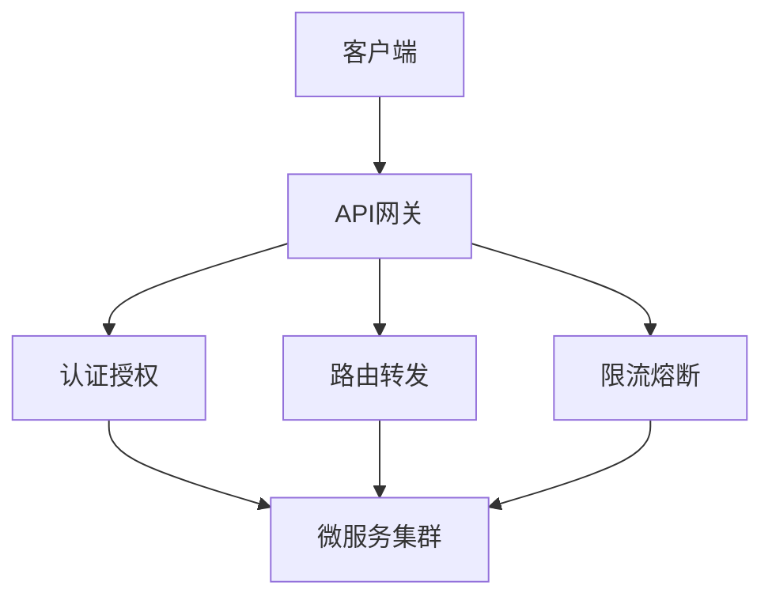

# API网关设计与实现：现代微服务架构的核心枢纽

## 引言：为什么需要API网关？

在微服务架构日益普及的今天，一个典型的电商系统可能包含数十甚至上百个独立的微服务：用户服务、商品服务、订单服务、支付服务等。每个服务都通过RESTful API或gRPC接口对外提供服务。当客户端（如Web前端、移动App）需要访问这些服务时，会面临几个关键问题：

1. **客户端复杂性**：客户端需要知道每个服务的地址、端口和API细节
2. **安全问题**：每个服务都需要单独实现认证和授权逻辑
3. **性能问题**：多次网络请求导致延迟增加
4. **运维困难**：服务版本管理、流量控制、监控等难以统一

API网关应运而生，它作为系统的**统一入口**，为所有客户端提供单一访问点，解决了上述问题。本文将深入探讨API网关的设计原理、实现细节和最佳实践。

## 技术原理详解

### 1. 核心架构模式

API网关采用**反向代理**模式，所有客户端请求首先到达网关，网关根据路由规则将请求转发到相应的后端服务。这种模式实现了**关注点分离**：网关处理横切关注点（cross-cutting concerns），后端服务专注于业务逻辑。



### 2. 关键技术组件

#### 2.1 路由引擎
路由是API网关的核心功能，它根据请求的URL、HTTP方法、头部信息等将请求转发到正确的后端服务。

**路由类型**：
- **路径路由**：`/api/users/*` → 用户服务
- **主机路由**：`api.example.com` → 特定服务集群
- **权重路由**：A/B测试、蓝绿部署

#### 2.2 过滤器链
网关通过过滤器链实现各种横切功能，每个过滤器处理特定的任务：

```
请求 → 认证过滤器 → 限流过滤器 → 日志过滤器 → 路由过滤器 → 响应转换过滤器 → 客户端
```

#### 2.3 服务发现集成
现代API网关需要与**服务注册中心**（如Consul、Eureka、Nacos）集成，实现动态服务发现。

### 3. 核心功能解析

#### 3.1 认证与授权
**术语解释**：
- **认证（Authentication）**：验证用户身份（你是谁？）
- **授权（Authorization）**：验证用户权限（你能做什么？）

网关通常支持多种认证方式：
- JWT（JSON Web Token）
- OAuth 2.0 / OpenID Connect
- API密钥
- 基本认证

#### 3.2 限流与熔断
- **限流（Rate Limiting）**：控制单位时间内的请求数量
- **熔断（Circuit Breaking）**：当后端服务故障时，快速失败，避免级联故障

#### 3.3 监控与日志
- 请求/响应日志
- 性能指标收集（延迟、错误率等）
- 分布式追踪集成

## 实战代码示例

### 示例1：基于Go的简单API网关实现

```go
package main

import (
    "fmt"
    "log"
    "net/http"
    "net/http/httputil"
    "net/url"
    "strings"
)

// 路由配置
type Route struct {
    PathPrefix string
    TargetURL  string
}

// 反向代理处理器
type ProxyHandler struct {
    routes []Route
    proxies map[string]*httputil.ReverseProxy
}

func NewProxyHandler() *ProxyHandler {
    return &ProxyHandler{
        routes: []Route{
            {PathPrefix: "/api/users/", TargetURL: "http://localhost:8081"},
            {PathPrefix: "/api/products/", TargetURL: "http://localhost:8082"},
            {PathPrefix: "/api/orders/", TargetURL: "http://localhost:8083"},
        },
        proxies: make(map[string]*httputil.ReverseProxy),
    }
}

func (h *ProxyHandler) ServeHTTP(w http.ResponseWriter, r *http.Request) {
    // 查找匹配的路由
    for _, route := range h.routes {
        if strings.HasPrefix(r.URL.Path, route.PathPrefix) {
            // 创建或获取反向代理实例
            proxy, exists := h.proxies[route.TargetURL]
            if !exists {
                target, _ := url.Parse(route.TargetURL)
                proxy = httputil.NewSingleHostReverseProxy(target)
                h.proxies[route.TargetURL] = proxy
            }
            
            // 添加认证头（示例）
            r.Header.Set("X-API-Gateway", "true")
            
            // 转发请求
            proxy.ServeHTTP(w, r)
            return
        }
    }
    
    http.NotFound(w, r)
}

// JWT认证中间件
func JWTAuthMiddleware(next http.Handler) http.Handler {
    return http.HandlerFunc(func(w http.ResponseWriter, r *http.Request) {
        token := r.Header.Get("Authorization")
        if token == "" {
            http.Error(w, "Unauthorized", http.StatusUnauthorized)
            return
        }
        
        // 验证JWT令牌（简化版）
        if !strings.HasPrefix(token, "Bearer ") {
            http.Error(w, "Invalid token format", http.StatusUnauthorized)
            return
        }
        
        // 这里应该添加实际的JWT验证逻辑
        log.Printf("JWT验证通过: %s", token)
        
        next.ServeHTTP(w, r)
    })
}

func main() {
    handler := NewProxyHandler()
    
    // 应用中间件链
    http.Handle("/", JWTAuthMiddleware(handler))
    
    fmt.Println("API网关启动在 :8080")
    log.Fatal(http.ListenAndServe(":8080", nil))
}
```

### 示例2：限流器实现（令牌桶算法）

```go
package main

import (
    "sync"
    "time"
)

// TokenBucket 令牌桶限流器
type TokenBucket struct {
    capacity     int           // 桶容量
    tokens       int           // 当前令牌数
    fillRate     int           // 每秒填充的令牌数
    lastFillTime time.Time     // 上次填充时间
    mu           sync.Mutex    // 互斥锁
}

func NewTokenBucket(capacity, fillRate int) *TokenBucket {
    return &TokenBucket{
        capacity:     capacity,
        tokens:       capacity,
        fillRate:     fillRate,
        lastFillTime: time.Now(),
    }
}

// Allow 检查是否允许请求通过
func (tb *TokenBucket) Allow() bool {
    tb.mu.Lock()
    defer tb.mu.Unlock()
    
    // 填充令牌
    now := time.Now()
    elapsed := now.Sub(tb.lastFillTime)
    tokensToAdd := int(elapsed.Seconds() * float64(tb.fillRate))
    
    if tokensToAdd > 0 {
        tb.tokens = min(tb.capacity, tb.tokens+tokensToAdd)
        tb.lastFillTime = now
    }
    
    // 检查是否有足够令牌
    if tb.tokens > 0 {
        tb.tokens--
        return true
    }
    
    return false
}

func min(a, b int) int {
    if a < b {
        return a
    }
    return b
}

// 使用示例
func main() {
    // 创建限流器：容量10个令牌，每秒填充5个
    limiter := NewTokenBucket(10, 5)
    
    // 模拟请求
    for i := 0; i < 20; i++ {
        if limiter.Allow() {
            println("请求通过:", i)
        } else {
            println("请求被限流:", i)
        }
        time.Sleep(100 * time.Millisecond)
    }
}
```

### 示例3：配置热加载实现

```yaml
# config.yaml
routes:
  - name: user-service
    path_prefix: "/api/users"
    target: "http://user-service:8080"
    rate_limit:
      requests_per_second: 100
    authentication: true
    
  - name: product-service
    path_prefix: "/api/products"
    target: "http://product-service:8081"
    rate_limit:
      requests_per_second: 200
    authentication: false
```

```go
package main

import (
    "gopkg.in/yaml.v3"
    "io/ioutil"
    "log"
    "sync"
    "time"
)

type RouteConfig struct {
    Name        string `yaml:"name"`
    PathPrefix  string `yaml:"path_prefix"`
    Target      string `yaml:"target"`
    RateLimit   struct {
        RequestsPerSecond int `yaml:"requests_per_second"`
    } `yaml:"rate_limit"`
    Authentication bool `yaml:"authentication"`
}

type