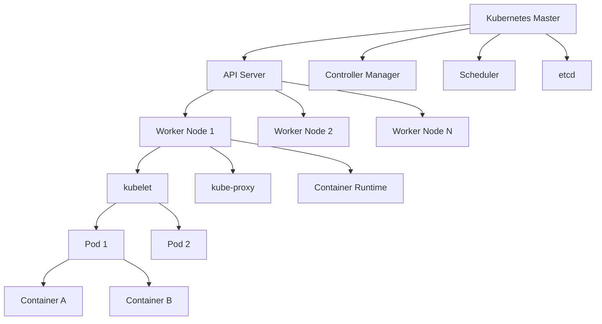

# Kubernetes在生产环境中的深度应用：从理论到实践

## 引言：现代云原生架构的挑战与机遇

在数字化转型的浪潮中，企业面临着前所未有的挑战：如何快速部署、弹性扩展和管理复杂的分布式应用系统？传统的单体架构和虚拟机部署模式已难以满足现代业务对敏捷性、可靠性和可扩展性的需求。这正是Kubernetes（常简称为K8s）应运而生的背景。

Kubernetes作为容器编排的事实标准，已经彻底改变了应用部署和管理的方式。根据CNCF 2023年的调查报告，**96%的组织正在使用或评估Kubernetes**，其中78%已将其用于生产环境。然而，将Kubernetes从测试环境迁移到生产环境并非简单的复制粘贴，它需要深入理解其核心原理、掌握最佳实践，并建立完善的操作流程。

## 技术原理详解

### 核心架构解析

Kubernetes采用主从（Master-Worker）架构，其核心组件协同工作，确保集群的稳定运行：



**关键术语解释**：
- **Pod**：Kubernetes的最小部署单元，包含一个或多个紧密相关的容器
- **Deployment**：声明式地管理Pod副本和更新策略
- **Service**：为Pod提供稳定的网络端点抽象
- **ConfigMap/Secret**：将配置数据和敏感信息与容器镜像解耦

### 控制器模式：Kubernetes的"大脑"

Kubernetes的核心设计理念是**声明式API和控制器模式**。用户声明期望状态（如"需要运行3个Nginx实例"），控制器持续观察实际状态，并通过协调循环驱动系统向期望状态收敛。

```go
// 简化的控制器逻辑示例
for {
    desiredState := getDesiredState()
    currentState := getCurrentState()
    
    if !statesEqual(desiredState, currentState) {
        reconcile(desiredState, currentState)
    }
    
    time.Sleep(resyncPeriod)
}
```

这种设计使得系统具有自我修复能力，能够自动处理节点故障、容器崩溃等异常情况。

## 实战代码示例

### 示例1：生产级Deployment配置

```yaml
apiVersion: apps/v1
kind: Deployment
metadata:
  name: webapp-production
  namespace: production
  labels:
    app: webapp
    environment: production
spec:
  replicas: 3  # 至少3个副本确保高可用
  revisionHistoryLimit: 10  # 保留10个历史版本用于回滚
  strategy:
    type: RollingUpdate
    rollingUpdate:
      maxSurge: 1  # 滚动更新时最多比期望副本数多1个
      maxUnavailable: 0  # 更新期间确保所有副本可用
  selector:
    matchLabels:
      app: webapp
  template:
    metadata:
      labels:
        app: webapp
        version: v1.2.3
    spec:
      containers:
      - name: webapp
        image: registry.company.com/webapp:v1.2.3
        imagePullPolicy: IfNotPresent
        ports:
        - containerPort: 8080
        resources:
          requests:
            memory: "256Mi"
            cpu: "250m"
          limits:
            memory: "512Mi"
            cpu: "500m"
        livenessProbe:
          httpGet:
            path: /health
            port: 8080
          initialDelaySeconds: 30
          periodSeconds: 10
          timeoutSeconds: 5
          failureThreshold: 3
        readinessProbe:
          httpGet:
            path: /ready
            port: 8080
          initialDelaySeconds: 5
          periodSeconds: 5
        env:
        - name: ENVIRONMENT
          value: "production"
        - name: CONFIG_FILE
          value: "/config/app.properties"
        volumeMounts:
        - name: config-volume
          mountPath: /config
      volumes:
      - name: config-volume
        configMap:
          name: webapp-config
      affinity:
        podAntiAffinity:
          preferredDuringSchedulingIgnoredDuringExecution:
          - weight: 100
            podAffinityTerm:
              labelSelector:
                matchExpressions:
                - key: app
                  operator: In
                  values:
                  - webapp
              topologyKey: kubernetes.io/hostname
```

### 示例2：服务网格配置（Istio示例）

```yaml
apiVersion: networking.istio.io/v1beta1
kind: VirtualService
metadata:
  name: webapp-virtualservice
spec:
  hosts:
  - webapp.production.svc.cluster.local
  http:
  - match:
    - headers:
        user-agent:
          regex: .*Mobile.*
    route:
    - destination:
        host: webapp.production.svc.cluster.local
        subset: mobile
      weight: 100
  - route:
    - destination:
        host: webapp.production.svc.cluster.local
        subset: desktop
      weight: 100
---
apiVersion: networking.istio.io/v1beta1
kind: DestinationRule
metadata:
  name: webapp-destinationrule
spec:
  host: webapp.production.svc.cluster.local
  subsets:
  - name: desktop
    labels:
      version: v1.2.3
  - name: mobile
    labels:
      version: v1.2.3-mobile
  trafficPolicy:
    connectionPool:
      tcp:
        maxConnections: 100
      http:
        http1MaxPendingRequests: 50
        maxRequestsPerConnection: 10
    outlierDetection:
      consecutive5xxErrors: 5
      interval: 30s
      baseEjectionTime: 30s
      maxEjectionPercent: 50
```

### 示例3：自定义资源定义（CRD）和Operator

```yaml
# 自定义资源定义
apiVersion: apiextensions.k8s.io/v1
kind: CustomResourceDefinition
metadata:
  name: databases.example.com
spec:
  group: example.com
  versions:
  - name: v1
    served: true
    storage: true
    schema:
      openAPIV3Schema:
        type: object
        properties:
          spec:
            type: object
            properties:
              databaseName:
                type: string
              storageGB:
                type: integer
              replicas:
                type: integer
                minimum: 1
                maximum: 5
  scope: Namespaced
  names:
    plural: databases
    singular: database
    kind: Database
    shortNames:
    - db
---
# 自定义资源实例
apiVersion: example.com/v1
kind: Database
metadata:
  name: production-db
spec:
  databaseName: "prod_app_db"
  storageGB: 100
  replicas: 3
```

## 最佳实践建议

### 1. 安全最佳实践

**最小权限原则**：为每个服务账户分配最小必要权限
```bash
# 创建最小权限的Role
kubectl create role pod-reader \
  --verb=get,list,watch \
  --resource=pods \
  --namespace=production
```

**网络策略**：实施零信任网络模型
```yaml
apiVersion: networking.k8s.io/v1
kind: NetworkPolicy
metadata:
  name: webapp-network-policy
spec:
  podSelector:
    matchLabels:
      app: webapp
  policyTypes:
  - Ingress
  - Egress
  ingress:
  - from:
    - podSelector:
        matchLabels:
          role: frontend
    ports:
    - protocol: TCP
      port: 8080
  egress:
  - to:
    - podSelector:
        matchLabels:
          role: database
    ports:
    - protocol: TCP
      port: 5432
```

### 2. 监控与可观测性

建立完整的监控栈：
- **指标收集**：Prometheus + Node Exporter
- **日志聚合**：EFK Stack（Elasticsearch, Fluentd, Kibana）
- **分布式追踪**：Jaeger或Zipkin
- **告警管理**：Alertmanager

### 3. 资源管理与优化

```yaml
# 使用Vertical Pod Autoscaler自动调整资源请求
apiVersion: autoscaling.k8s.io/v1
kind: VerticalPodAutoscaler
metadata:
  name: webapp-vpa
spec:
  targetRef:
    apiVersion: "apps/v1"
