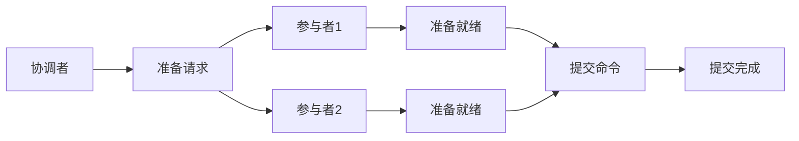

# 分布式事务：从理论到实践的完整指南

## 引言：当数据库开始“异地恋”

想象一下这个场景：你在电商平台下单，库存系统扣减库存，支付系统处理付款，积分系统增加积分——这些操作分布在不同的服务器、甚至不同的数据中心。如果其中某个步骤失败，其他已经成功的操作该怎么办？这就是分布式事务要解决的核心问题。

在单体应用时代，数据库事务相对简单。但随着微服务架构的流行，我们的数据开始了一场“异地恋”，而分布式事务就是确保这场恋爱不会变成“你爱我时我不爱你”的混乱局面。

## 一、分布式事务的挑战

### 1.1 CAP定理：分布式系统的“不可能三角”

CAP定理告诉我们，在分布式系统中，一致性（Consistency）、可用性（Availability）和分区容错性（Partition tolerance）三者不可兼得。这个定理就像告诉你：你不可能同时拥有高薪、轻松和有意义的工作——总要有所取舍。

**实用建议**：在实际应用中，大多数系统选择AP（可用性+分区容错性），通过最终一致性来弥补强一致性的缺失。

### 1.2 网络的不确定性

分布式事务面临的最大敌人是网络：
- 网络延迟：请求可能迟到，但不会缺席（或者真的缺席了）
- 网络分区：服务之间失去联系
- 消息丢失：重要的通知“已读不回”

## 二、主流分布式事务解决方案

### 2.1 两阶段提交（2PC）：传统的“婚礼主持人”

**工作原理**：
1. **准备阶段**：协调者询问所有参与者“你准备好了吗？”
2. **提交阶段**：如果所有人都说“我愿意”，协调者宣布“现在你们可以提交了”



**优点**：强一致性保证
**缺点**：
- 同步阻塞：所有参与者都要等待
- 单点故障：协调者挂了全盘皆输
- 数据不一致风险：第二阶段可能部分成功

**经验分享**：2PC适合对一致性要求极高的金融场景，但要做好性能下降的准备。

### 2.2 三阶段提交（3PC）：2PC的“优化版”

在2PC的基础上增加了超时机制和预提交阶段，减少了阻塞时间，但实现更复杂。就像给婚礼增加了“订婚”环节，虽然更稳妥，但流程更繁琐。

### 2.3 TCC模式：业务层的“手动挡”

TCC（Try-Confirm-Cancel）将事务拆分为三个阶段：

1. **Try**：预留资源（冻结库存、预扣款）
2. **Confirm**：确认操作（实际扣减）
3. **Cancel**：取消预留（解冻资源）

**实战示例**：
```java
// 订单服务
public interface OrderService {
    @Transactional
    boolean tryCreateOrder(Order order);  // 预创建订单
    
    boolean confirmCreateOrder(Long orderId);  // 确认创建
    
    boolean cancelCreateOrder(Long orderId);  // 取消创建
}
```

**优点**：性能较好，避免了长事务锁
**缺点**：业务侵入性强，需要为每个服务实现三个方法

**实用建议**：使用TCC时，一定要做好幂等性设计和重试机制，防止重复执行。

### 2.4 Saga模式：长事务的“接力赛”

Saga将长事务拆分为一系列本地事务，每个事务都有对应的补偿操作。

**两种实现方式**：
- **协同式**：每个服务完成后通知下一个服务
- **编排式**：由协调中心统一调度


**经验分享**：Saga适合业务流程长、步骤多的场景，但要特别注意补偿操作的实现要可靠。

### 2.5 本地消息表：异步的“可靠信使”

**核心思想**：将分布式事务拆分为本地事务+异步消息

**实现步骤**：
1. 业务操作和消息记录在同一个本地事务中
2. 消息服务定时轮询发送消息
3. 消费者处理消息并确认

**优点**：简单可靠，最终一致性
**缺点**：消息延迟，需要维护消息表

### 2.6 最大努力通知：佛系的“事务观”

适用于对一致性要求不高的场景，系统会“尽最大努力”通知，但不保证一定成功。就像你给朋友发微信，发了就认为他看到了，没看到...那就再发一次。

## 三、选型指南：如何选择合适的事务方案

### 3.1 决策矩阵

| 方案 | 一致性 | 性能 | 复杂度 | 适用场景 |
|------|--------|------|--------|----------|
| 2PC | 强一致 | 低 | 中 | 金融核心交易 |
| TCC | 最终一致 | 高 | 高 | 电商、订单 |
| Saga | 最终一致 | 中 | 高 | 长流程业务 |
| 本地消息表 | 最终一致 | 中 | 低 | 大多数业务 |
| 最大努力通知 | 弱一致 | 高 | 低 | 通知类业务 |

### 3.2 实用建议

1. **能不用分布式事务就不用**
   - 优先考虑业务拆分，避免分布式事务
   - 使用最终一致性替代强一致性

2. **根据业务场景选择**
   - 支付、交易：2PC或TCC
   - 订单、物流：Saga或本地消息表
   - 通知、日志：最大努力通知

3. **做好监控和告警**
   - 监控事务成功率
   - 设置合理的超时时间
   - 实现事务可视化追踪

## 四、实战经验分享

### 4.1 我们踩过的坑

**坑1：网络超时设置不当**
- 问题：2PC协调者等待超时时间太短，频繁回滚
- 解决：根据实际网络状况和业务处理时间动态调整超时

**坑2：补偿操作不幂等**
- 问题：Saga补偿操作被重复执行，数据错乱
- 解决：所有补偿操作都要实现幂等性

**坑3：消息顺序问题**
- 问题：本地消息表消息乱序到达
- 解决：使用版本号或时间戳保证顺序处理

### 4.2 最佳实践

1. **设计阶段**
   ```java
   // 好的设计：明确的事务边界
   @Transactional
   public void createOrder(OrderDTO order) {
       // 1. 参数校验（非事务操作）
       validate(order);
       
       // 2. 核心事务操作
       orderService.create(order);
       inventoryService.deduct(order);
       
       // 3. 发送异步消息（事务外）
       sendMessageAsync(order);
   }
   ```

2. **实现阶段**
   - 使用成熟的框架：Seata、ByteTCC、ServiceComb Saga
   - 统一异常处理
   - 完善的日志记录

3. **运维阶段**
   - 定期检查事务表
   - 设置事务看板
   - 准备人工干预流程

## 五、未来展望

随着技术的发展，分布式事务也在不断演进：

1. **Serverless架构下的新挑战**：函数即服务的无状态特性需要新的事务模型
2. **区块链的启发**：共识算法可能为分布式事务提供新思路
3. **AI辅助的事务管理**：智能预测和自动修复

## 结语

分布式事务没有银弹，只有合适的解决方案。就像婚姻咨询师无法保证每段关系都完美，但可以提供让关系更健康的方法。选择合适的事务方案，理解其权衡，做好监控和容错，你的分布式系统就能在复杂的环境中保持优雅和稳定。

记住：好的系统设计不是避免问题，而是让问题发生时，系统能够优雅地处理。分布式事务也是如此——我们无法避免所有故障，但可以确保故障发生时，系统知道如何恢复。

**最后的小贴士**：当你为分布式事务头疼时，不妨问问自己：这个问题真的需要分布式事务解决吗？有时候，简化业务逻辑比引入复杂的技术方案更有效。

---

*希望这篇指南能帮助你在分布式事务的海洋中找到方向。如果你有更多经验或问题，欢迎在评论区分享讨论！*