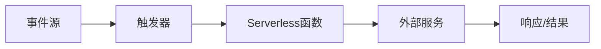

# Serverless架构：优势、挑战与实战指南

## 引言：从传统架构到Serverless的演进

在云计算发展的早期阶段，企业需要自行管理物理服务器，随后虚拟化技术让虚拟机成为主流。随着容器技术的兴起，Kubernetes等编排工具进一步简化了部署流程。然而，这些架构仍然要求开发者关注服务器管理、扩展性和可用性等问题。

**Serverless架构**应运而生，它代表了云计算演进的下一阶段。在Serverless模型中，开发者只需关注业务逻辑代码，而无需管理底层基础设施。云服务提供商自动处理服务器的配置、扩展、维护和监控。这种"按需付费"的模式，让计算资源真正成为像水电一样的公共设施。

但Serverless并非银弹，它在带来便利的同时也引入了新的挑战。本文将深入探讨Serverless架构的技术原理、优势挑战，并提供实用的代码示例和最佳实践。

## 技术原理详解

### 核心概念解析

**函数即服务（FaaS）**：Serverless的核心组件，允许开发者部署独立的函数，这些函数在事件触发时执行。常见的FaaS平台包括AWS Lambda、Azure Functions和Google Cloud Functions。

**事件驱动架构**：Serverless函数通常由事件触发，如HTTP请求、数据库更改、消息队列消息或文件上传等。

**无状态设计**：Serverless函数应该是无状态的，任何需要持久化的数据都应存储在外部服务中。

### 工作流程



### 关键技术特性

1. **自动扩展**：根据负载自动创建或销毁函数实例
2. **按使用付费**：只对实际执行时间和资源消耗付费
3. **零服务器管理**：无需配置、维护或监控服务器
4. **内置高可用性**：自动跨多个可用区部署

## 实战代码示例

### 示例1：AWS Lambda函数处理S3文件上传

```python
import json
import boto3
from PIL import Image
import io

s3 = boto3.client('s3')

def lambda_handler(event, context):
    """
    处理S3文件上传事件的Lambda函数
    自动创建图片缩略图
    """
    # 从事件中获取桶名和文件名
    bucket = event['Records'][0]['s3']['bucket']['name']
    key = event['Records'][0]['s3']['object']['key']
    
    # 只处理图片文件
    if not key.lower().endswith(('.png', '.jpg', '.jpeg')):
        return {
            'statusCode': 200,
            'body': json.dumps('非图片文件，跳过处理')
        }
    
    try:
        # 下载原始图片
        response = s3.get_object(Bucket=bucket, Key=key)
        image_content = response['Body'].read()
        
        # 使用PIL创建缩略图
        image = Image.open(io.BytesIO(image_content))
        image.thumbnail((200, 200))
        
        # 转换回字节
        buffer = io.BytesIO()
        image.save(buffer, 'JPEG')
        buffer.seek(0)
        
        # 上传缩略图到S3
        thumbnail_key = f"thumbnails/{key}"
        s3.put_object(
            Bucket=bucket,
            Key=thumbnail_key,
            Body=buffer,
            ContentType='image/jpeg'
        )
        
        return {
            'statusCode': 200,
            'body': json.dumps(f'缩略图创建成功: {thumbnail_key}')
        }
        
    except Exception as e:
        print(f"处理失败: {str(e)}")
        raise e
```

### 示例2：使用Serverless Framework部署API

```yaml
# serverless.yml
service: user-api

provider:
  name: aws
  runtime: python3.9
  region: us-east-1
  environment:
    USERS_TABLE: ${self:service}-users-${opt:stage, self:provider.stage}

functions:
  createUser:
    handler: handler.create_user
    events:
      - http:
          path: users
          method: post
          cors: true
  
  getUser:
    handler: handler.get_user
    events:
      - http:
          path: users/{id}
          method: get
          cors: true

resources:
  Resources:
    UsersTable:
      Type: AWS::DynamoDB::Table
      Properties:
        TableName: ${self:provider.environment.USERS_TABLE}
        AttributeDefinitions:
          - AttributeName: userId
            AttributeType: S
        KeySchema:
          - AttributeName: userId
            KeyType: HASH
        BillingMode: PAY_PER_REQUEST
```

```python
# handler.py
import json
import boto3
import uuid
from datetime import datetime

dynamodb = boto3.resource('dynamodb')
table = dynamodb.Table('user-api-users-dev')

def create_user(event, context):
    """创建用户"""
    try:
        body = json.loads(event['body'])
        user_id = str(uuid.uuid4())
        
        item = {
            'userId': user_id,
            'name': body['name'],
            'email': body['email'],
            'createdAt': datetime.now().isoformat(),
            'updatedAt': datetime.now().isoformat()
        }
        
        table.put_item(Item=item)
        
        return {
            'statusCode': 201,
            'body': json.dumps({
                'userId': user_id,
                'message': '用户创建成功'
            })
        }
    except Exception as e:
        return {
            'statusCode': 500,
            'body': json.dumps({'error': str(e)})
        }

def get_user(event, context):
    """获取用户信息"""
    try:
        user_id = event['pathParameters']['id']
        
        response = table.get_item(Key={'userId': user_id})
        
        if 'Item' not in response:
            return {
                'statusCode': 404,
                'body': json.dumps({'error': '用户不存在'})
            }
        
        return {
            'statusCode': 200,
            'body': json.dumps(response['Item'])
        }
    except Exception as e:
        return {
            'statusCode': 500,
            'body': json.dumps({'error': str(e)})
        }
```

### 示例3：冷启动优化策略

```python
import json
import boto3
import time

# 全局变量 - 在冷启动时初始化，热启动时复用
dynamodb_client = None
s3_client = None
config_cache = {}

def initialize_clients():
    """初始化客户端连接"""
    global dynamodb_client, s3_client, config_cache
    
    if dynamodb_client is None:
        print("初始化DynamoDB客户端...")
        dynamodb_client = boto3.client('dynamodb', 
                                      region_name='us-east-1')
    
    if s3_client is None:
        print("初始化S3客户端...")
        s3_client = boto3.client('s3')
    
    # 预加载配置数据
    if not config_cache:
        print("加载配置数据...")
        # 这里可以预加载常用配置
        config_cache['app_config'] = {
            'max_retries': 3,
            'timeout': 30,
            'feature_flags': {
                'new_ui': True,
                'beta_features': False
            }
        }

def lambda_handler(event, context):
    """
    优化冷启动的Lambda函数示例
    使用全局变量和预初始化技术
    """
    start_time = time.time()
    
    # 初始化客户端（冷启动时执行，热启动时跳过）
    initialize_clients()
    
    # 业务逻辑
    try:
        # 使用预加载的配置
        max_retries = config_cache['app_config']['max_retries']
        
        # 模拟业务处理
        result = {
            'processed': True,
            'config': config_cache['app_config'],
            'execution_time': time.time() - start_time,
            'remaining_time': context.get_remaining_time_in_millis()
        }
        
        return {
            'statusCode': 200,
            'body': json.dumps(result)
        }
        
    except Exception as e:
        return {
            'statusCode': 500,
            'body': json.dumps({'error': str(e)})
        }
```

## 最佳实践建议

### 1. 函数设计原则

**单一职责原则**：每个函数应该只做一件事，并且做好。避免创建"全能"函数。

**保持函数轻量**：函数包大小应尽可能小，减少冷启动时间。AWS Lambda建议部署包小于50MB。

**实现幂等性**：确保函数可以安全地多次执行而不产生副作用。

### 2. 性能优化策略

**连接池管理**：在函数外部初始化数据库连接，并在多个调用间复用。

**内存配置优化**：适当增加内存分配可以显著提高CPU性能和执行时间。

**使用Provisioned Concurrency**：对于关键业务函数，使用预置