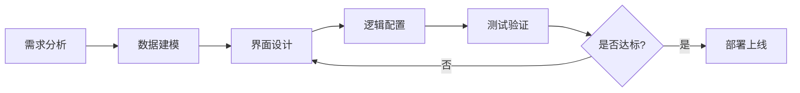

# 低代码革命：技术解析与实战指南

## 引言：当编程变得“可视化”

想象一下，你正在构建一个企业管理系统。传统方式下，你需要编写数千行代码，调试数周时间。而现在，通过拖拽组件、配置属性，几小时内就能搭建出功能完整的应用——这就是低代码平台带来的变革。

低代码开发平台（LCDP）正在以每年超过20%的速度增长，到2025年市场规模预计将达到455亿美元。但低代码究竟是什么？它如何工作？又该如何有效利用？本文将深入解析低代码平台的技术内核，并分享实用建议。

## 低代码平台的技术架构解析

### 核心三层架构

**1. 可视化设计层**
这是用户直接交互的界面，通常包含：
- 拖拽式UI构建器
- 可视化流程设计器
- 数据模型设计工具
- 业务规则配置面板

**技术实现**：现代低代码平台多采用React/Vue等前端框架，结合Canvas API实现拖拽功能。组件库通常采用微前端架构，支持动态加载。

```javascript
// 简化的组件注册示例
platform.registerComponent({
  name: 'data-table',
  config: {
    dataSource: 'dynamic',
    columns: 'configurable',
    pagination: true
  },
  render: (props) => <DataTable {...props} />
});
```

**2. 模型驱动引擎**
这是低代码平台的大脑，负责：
- 将可视化配置转换为可执行代码
- 管理数据模型和业务逻辑
- 处理工作流和权限控制

**关键技术**：
- 元数据驱动：所有配置以结构化数据存储
- 代码生成器：将模型转换为目标代码（如JavaScript、Java）
- 解释器引擎：实时执行配置的业务逻辑

**3. 运行时环境**
提供应用运行所需的基础设施：
- 容器化部署支持
- 数据库连接池
- API网关
- 监控和日志系统

### 数据持久化策略

低代码平台通常采用混合数据存储方案：

```sql
-- 平台元数据表结构示例
CREATE TABLE app_metadata (
  id UUID PRIMARY KEY,
  app_id VARCHAR(50),
  component_config JSONB,
  data_model JSONB,
  business_logic JSONB,
  version INTEGER,
  created_at TIMESTAMP
);

-- 应用数据表（动态生成）
-- 平台根据配置自动创建
```

## 低代码平台的核心技术挑战与解决方案

### 1. 性能优化挑战

**问题**：可视化操作生成大量元数据，可能影响性能

**解决方案**：
- 增量编译：只重新生成变更部分
- 懒加载组件：按需加载组件代码
- 缓存策略：多级缓存元数据

```javascript
// 增量编译示例
class IncrementalCompiler {
  compile(changes) {
    const affectedComponents = this.detectImpact(changes);
    return this.generatePartialCode(affectedComponents);
  }
}
```

### 2. 扩展性设计

**问题**：如何平衡易用性和灵活性

**解决方案**：
- 插件架构：支持自定义组件和连接器
- 代码嵌入点：允许插入原生代码
- API优先设计：所有功能都可通过API访问

### 3. 多租户支持

**问题**：为不同客户提供隔离环境

**解决方案**：
- 数据库分片或schema隔离
- 资源配额管理
- 自定义域名支持

## 实战建议：如何有效利用低代码平台

### 选择合适的应用场景

**适合低代码的场景**：
✅ 企业内部管理系统（CRM、ERP、OA）
✅ 数据收集和报表应用
✅ 简单的工作流自动化
✅ 原型开发和概念验证

**需要谨慎的场景**：
⚠️ 高性能计算应用
⚠️ 复杂的算法密集型系统
⚠️ 需要深度定制UI/UX的场景
⚠️ 对安全性有极高要求的系统

### 开发最佳实践

**1. 设计先行**
- 先设计数据模型，再构建界面
- 建立统一的组件规范
- 规划好权限体系

**2. 迭代开发**


**3. 混合开发策略**
- 80%使用低代码快速构建
- 20%通过自定义代码增强功能
- 建立组件库，复用优秀解决方案

### 性能优化技巧

1. **数据库优化**
   - 合理设计索引
   - 避免N+1查询问题
   - 使用分页加载大数据集

2. **前端优化**
   - 减少不必要的重新渲染
   - 懒加载非关键组件
   - 优化图片和静态资源

3. **缓存策略**
   - 缓存频繁访问的配置数据
   - 实现合理的缓存失效机制

## 低代码平台的未来趋势

### 1. AI增强开发
- 自然语言生成应用
- 智能代码补全
- 自动测试用例生成

### 2. 多平台支持
- 一次开发，多端部署
- 渐进式Web应用支持
- 跨平台移动应用

### 3. 生态整合
- 与云服务深度集成
- DevOps流水线自动化
- 微服务架构支持

## 结语：低代码不是银弹，而是强大工具

低代码平台正在改变软件开发的面貌，但它不是万能的。成功的低代码实践需要：

1. **正确的期望管理**：理解低代码的优势和局限
2. **技能升级**：学习新的开发范式，而不仅仅是工具使用
3. **流程适配**：调整团队协作方式以适应可视化开发
4. **持续优化**：定期重构和优化低代码应用

记住，低代码的目标不是取代开发者，而是**增强开发能力**。它让开发者从重复性工作中解放出来，专注于创造更大价值。

正如一位资深开发者所说：“低代码让我从‘写代码的工人’变成了‘设计解决方案的架构师’。”在这个快速变化的时代，掌握低代码技术，就是掌握了快速响应业务变化的能力。

---

**延伸阅读建议**：
- 学习至少一个主流低代码平台（如OutSystems、Mendix、Power Apps）
- 了解现代前端框架（React/Vue）以更好地理解低代码原理
- 关注Serverless和微服务架构，这是低代码的重要支撑技术

低代码革命已经到来，你是要观望，还是要参与其中？选择权在你手中。