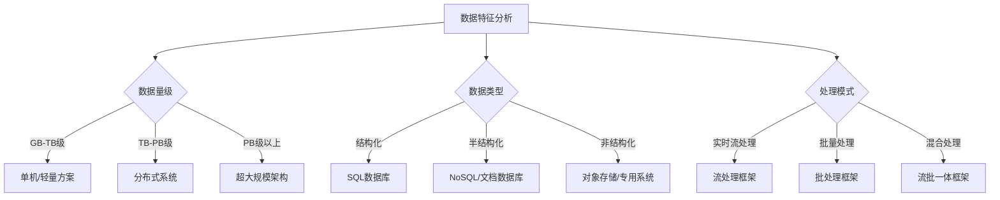

# 大数据处理技术选型指南：如何为你的项目选择最佳技术栈

> 在大数据的世界里，选择合适的技术就像在自助餐厅挑选菜品——眼花缭乱的选择可能让你不知所措，但正确的组合能让你的数据大餐既美味又营养。

## 引言：为什么技术选型如此重要？

想象一下，你正在建造一座摩天大楼。你会用搭建小木屋的工具吗？当然不会！同样，处理百万级数据和处理十亿级数据需要的技术栈完全不同。错误的技术选型可能导致：

- **性能瓶颈**：系统在数据量增长时崩溃
- **成本失控**：硬件和维护费用超出预算
- **开发效率低下**：团队花费大量时间与不合适的工具斗争
- **扩展困难**：无法适应业务快速增长

据Gartner调查，**超过60%的大数据项目失败**，其中技术选型不当是主要原因之一。今天，我将带你了解如何避免这些陷阱。

## 大数据技术选型决策框架

### 第一步：明确你的“数据画像”

在考虑任何技术之前，先回答这些问题：



**关键问题清单：**
1. 数据量有多大？未来增长预期如何？
2. 数据主要是什么类型？（结构化、半结构化、非结构化）
3. 数据处理是实时、近实时还是批处理？
4. 数据更新频率如何？
5. 查询模式是什么？（点查询、范围查询、复杂分析）

### 第二步：了解主流技术生态

#### 批处理领域
- **Hadoop MapReduce**：老牌选手，适合超大规模批处理，但编程模型复杂
- **Apache Spark**：内存计算王者，比MapReduce快10-100倍，生态丰富
- **Apache Flink**：虽然以流处理闻名，但批处理能力也很强

**经验分享**：我们曾有一个ETL项目，最初使用MapReduce，每天运行需要6小时。迁移到Spark后，同样的任务**仅需25分钟**，而且代码量减少了40%。

#### 流处理领域
- **Apache Kafka Streams**：轻量级，与Kafka深度集成
- **Apache Flink**：真正的流处理，低延迟，Exactly-Once语义
- **Apache Spark Streaming**：微批处理，适合准实时场景

**实用建议**：如果延迟要求低于100ms，选Flink；如果1-2秒可接受，Spark Streaming可能更简单。

#### 存储层选择
```markdown
| 存储类型       | 代表技术         | 最佳使用场景                 | 注意事项                 |
|----------------|------------------|----------------------------|------------------------|
| 分布式文件系统 | HDFS             | 海量数据存储，批处理        | 小文件问题严重          |
| 对象存储       | AWS S3, 阿里云OSS| 成本敏感，数据湖基础        | 随机读写性能较差        |
| 列式存储       | Apache Parquet   | 分析型查询，高压缩比        | 不适合频繁更新          |
| 键值存储       | HBase, Cassandra | 高吞吐读写，快速点查询      | 复杂查询能力有限        |
```

#### 资源管理与调度
- **YARN**：Hadoop生态标准，稳定但复杂
- **Kubernetes**：云原生时代的选择，灵活但学习曲线陡峭
- **Mesos**：逐渐被Kubernetes取代

### 第三步：匹配业务场景与技术

#### 场景一：实时推荐系统
**需求**：毫秒级响应，处理用户实时行为数据

**推荐技术栈**：
```
数据采集：Apache Kafka
流处理：Apache Flink
特征存储：Redis
模型服务：TensorFlow Serving
结果存储：Cassandra
```

#### 场景二：企业数据仓库
**需求**：T+1报表，复杂SQL分析，高并发查询

**推荐技术栈**：
```
数据集成：Apache NiFi
批处理：Apache Spark
查询引擎：Presto/Trino
数据湖：Delta Lake/Iceberg/Hudi
BI工具：Superset/Tableau
```

#### 场景三：物联网数据处理
**需求**：海量设备数据，时序特性，高写入吞吐

**推荐技术栈**：
```
消息队列：Apache Kafka
时序数据库：InfluxDB/TDengine
流处理：Apache Flink
冷数据存储：对象存储+S3 Select
```

### 第四步：考虑非技术因素

技术选型不只是技术问题：

1. **团队技能**：选择团队熟悉或有学习意愿的技术
2. **社区活跃度**：GitHub stars、提交频率、问题响应时间
3. **商业支持**：是否有可靠的商业公司提供支持
4. **云服务集成**：与你的云服务商兼容性如何
5. **总拥有成本**：包括开发、运维、硬件和许可费用

**真实案例**：某金融公司选择了理论上最优的Flink，但团队只有Spark经验。结果项目延期3个月，直到他们重新培训团队才走上正轨。

## 常见陷阱与避坑指南

### 陷阱1：盲目追求新技术
> “我们用Flink吧，它是最新的！”——没有考虑实际需求

**避坑**：新技术可能有未知问题。对于关键业务系统，选择成熟度与技术先进性平衡的方案。

### 陷阱2：过度设计
> “我们的日活只有1万，但我们要用Hadoop集群处理所有数据”

**避坑**：从小规模开始，验证技术路线。很多场景下，PostgreSQL + 适当索引就能解决问题。

### 陷阱3：忽视数据治理
> “我们先存数据，以后再考虑质量”

**避坑**：从一开始就考虑数据质量、元数据管理和数据血缘。工具如Apache Atlas、DataHub值得早期引入。

### 陷阱4：单点解决方案思维
> “这个工具能解决我们所有问题”

**避坑**：大数据是生态系统，选择能良好集成的组件。参考成熟架构如Lambda或Kappa架构。

## 技术选型检查清单

在最终决定前，请确认：

- [ ] 技术满足当前和未来1-2年的业务需求
- [ ] 团队有相应技能或可行的学习计划
- [ ] 社区活跃，有足够的学习资源
- [ ] 与现有系统能良好集成
- [ ] 考虑了运维复杂度和成本
- [ ] 有可行的POC验证了关键技术假设
- [ ] 制定了回滚或迁移计划

## 未来趋势与建议

1. **云原生成为标配**：Kubernetes + 容器化部署
2. **流批一体架构**：Flink引领的趋势，简化架构
3. **数据湖仓一体**：Delta Lake、Iceberg等技术的兴起
4. **Serverless数据处理**：按使用量付费，降低运维负担

**个人建议**：保持架构的灵活性。大数据领域变化迅速，今天的最佳实践明天可能过时。设计松耦合的组件，为未来技术演进留出空间。

## 结语

大数据技术选型没有“银弹”，最好的选择是最适合你特定场景的选择。记住这个简单的公式：

**成功选型 = 业务理解 × 技术评估 × 团队能力 × 成本控制**

开始你的选型之旅吧，但不要害怕调整方向。在大数据的世界里，唯一不变的就是变化本身。明智的选择不是找到完美的工具，而是建立能够适应变化的架构和团队。

---

*本文基于作者多年大数据架构经验编写，实际选型请结合具体场景。如果你有特定场景需要建议，欢迎在评论区讨论！*