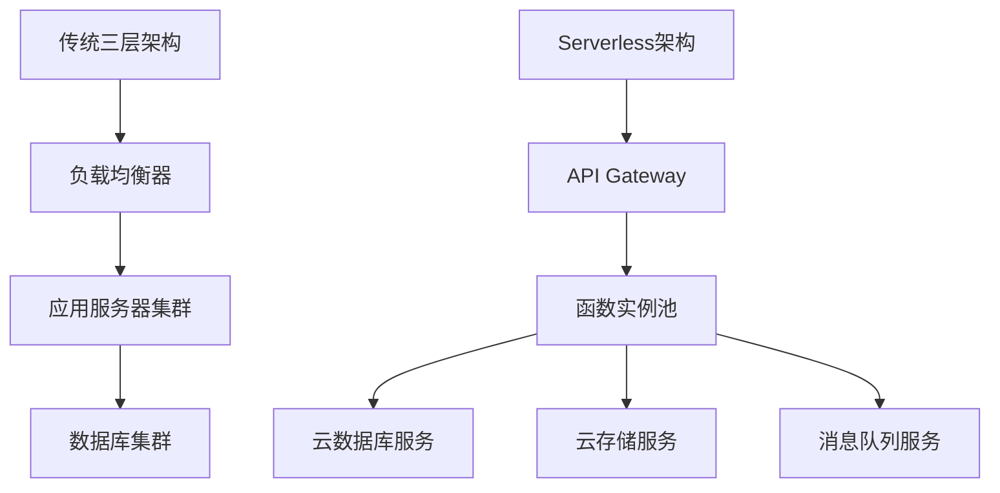

# Serverless架构：优势、挑战与实战指南

## 引言：从传统架构到Serverless的演进

在云计算发展的早期阶段，企业需要自行管理物理服务器、虚拟机和容器。随着云原生技术的成熟，一种新的架构范式——Serverless（无服务器）架构应运而生。Serverless并非真的"无服务器"，而是将服务器管理、资源分配和扩展性等底层基础设施问题完全交给云服务提供商，开发者只需专注于业务逻辑的实现。

传统架构面临的核心问题包括：
- **资源浪费**：为应对流量高峰而过度配置资源
- **运维复杂**：需要专业的运维团队管理基础设施
- **扩展延迟**：手动扩展无法应对突发流量
- **成本优化困难**：难以精确匹配资源使用与实际需求

Serverless架构通过事件驱动、按需执行和自动扩展的特性，为解决这些问题提供了新的思路。

## 技术原理详解

### 核心概念解析

**函数即服务（FaaS）**：Serverless的核心组件，允许开发者部署独立的函数，这些函数在特定事件触发时执行。云提供商负责管理执行环境、资源分配和扩展。

**事件驱动架构**：Serverless函数通过事件触发，这些事件可以来自HTTP请求、消息队列、数据库变更、文件上传等多种来源。

**冷启动与热启动**：
- **冷启动**：函数首次执行或长时间未执行后的启动，需要初始化运行环境
- **热启动**：函数在短时间内再次执行，复用已有的运行环境

### 技术架构对比



### 关键技术术语解释

**执行时长限制**：云提供商对函数单次执行时间的限制（通常5-15分钟）

**并发限制**：同时执行的函数实例数量上限

**按使用付费**：只对实际执行的函数计费，而非预留资源

**状态管理**：Serverless函数通常设计为无状态的，持久化状态存储在外部服务中

## 实战代码示例

### 示例1：AWS Lambda函数处理图像上传

```python
import boto3
import json
from PIL import Image
import io
import os

s3 = boto3.client('s3')
rekognition = boto3.client('rekognition')

def lambda_handler(event, context):
    """
    处理S3图像上传事件，生成缩略图并进行内容分析
    """
    # 解析S3事件
    bucket = event['Records'][0]['s3']['bucket']['name']
    key = event['Records'][0]['s3']['object']['key']
    
    # 下载原始图像
    response = s3.get_object(Bucket=bucket, Key=key)
    image_data = response['Body'].read()
    
    # 生成缩略图
    image = Image.open(io.BytesIO(image_data))
    image.thumbnail((200, 200))
    
    thumbnail_buffer = io.BytesIO()
    image.save(thumbnail_buffer, format='JPEG')
    thumbnail_buffer.seek(0)
    
    # 上传缩略图
    thumbnail_key = f"thumbnails/{key}"
    s3.put_object(
        Bucket=bucket,
        Key=thumbnail_key,
        Body=thumbnail_buffer,
        ContentType='image/jpeg'
    )
    
    # 使用Rekognition进行图像分析
    rekognition_response = rekognition.detect_labels(
        Image={'S3Object': {'Bucket': bucket, 'Name': key}},
        MaxLabels=10
    )
    
    # 存储分析结果到DynamoDB
    dynamodb = boto3.resource('dynamodb')
    table = dynamodb.Table('ImageAnalysisResults')
    
    table.put_item(Item={
        'image_key': key,
        'labels': [label['Name'] for label in rekognition_response['Labels']],
        'timestamp': context.aws_request_id,
        'thumbnail_path': thumbnail_key
    })
    
    return {
        'statusCode': 200,
        'body': json.dumps('Image processed successfully')
    }
```

### 示例2：Azure Functions HTTP触发器

```csharp
using System.IO;
using System.Threading.Tasks;
using Microsoft.AspNetCore.Mvc;
using Microsoft.Azure.WebJobs;
using Microsoft.Azure.WebJobs.Extensions.Http;
using Microsoft.AspNetCore.Http;
using Microsoft.Extensions.Logging;
using Newtonsoft.Json;

namespace OrderProcessing
{
    public static class ProcessOrder
    {
        [FunctionName("ProcessOrder")]
        public static async Task<IActionResult> Run(
            [HttpTrigger(AuthorizationLevel.Function, "post", Route = null)] HttpRequest req,
            [Queue("orders", Connection = "AzureWebJobsStorage")] IAsyncCollector<string> orderQueue,
            ILogger log)
        {
            log.LogInformation("C# HTTP trigger function processed a request.");

            // 读取请求体
            string requestBody = await new StreamReader(req.Body).ReadToEndAsync();
            dynamic orderData = JsonConvert.DeserializeObject(requestBody);
            
            // 验证订单数据
            if (orderData?.customerId == null || orderData?.items == null)
            {
                return new BadRequestObjectResult("Invalid order data");
            }
            
            // 添加处理元数据
            orderData.processedAt = DateTime.UtcNow;
            orderData.orderId = Guid.NewGuid().ToString();
            
            string orderMessage = JsonConvert.SerializeObject(orderData);
            
            // 将订单添加到队列进行异步处理
            await orderQueue.AddAsync(orderMessage);
            
            // 返回即时响应
            return new OkObjectResult(new {
                message = "Order received and queued for processing",
                orderId = orderData.orderId,
                estimatedCompletion = DateTime.UtcNow.AddMinutes(5)
            });
        }
    }
}
```

### 示例3：Google Cloud Functions环境配置与部署

```yaml
# serverless.yaml - Serverless Framework配置文件
service: image-processing-service

provider:
  name: google
  runtime: nodejs14
  region: us-central1
  project: ${env:GCP_PROJECT}
  credentials: ${env:GCP_CREDENTIALS}
  
  # 环境变量配置
  environment:
    MAX_IMAGE_SIZE: "10485760"  # 10MB
    ALLOWED_FORMATS: "jpg,jpeg,png,gif"
    THUMBNAIL_WIDTH: "300"
    THUMBNAIL_HEIGHT: "300"
    
  # IAM角色配置
  iamRoleStatements:
    - Effect: Allow
      Action:
        - storage.objects.get
        - storage.objects.put
      Resource: "projects/_/buckets/${self:service}-images/*"

functions:
  processImage:
    handler: processImage
    events:
      - event:
          eventType: google.storage.object.finalize
          resource: projects/_/buckets/${self:service}-images/objects/{fileName}
    
  generateReport:
    handler: generateReport
    events:
      - http: true
        path: report
        method: get
    memorySize: 2048  # 分配2GB内存
    timeout: 300  # 5分钟超时

resources:
  resources:
    - type: gcp-types/storage-v1:buckets
      name: ${self:service}-images
      properties:
        location: US
        storageClass: STANDARD
```

## 最佳实践建议

### 1. 函数设计原则

**单一职责原则**：每个函数应该只做一件事，并且做好
```javascript
// 不好的实践：一个函数做多件事
async function processUserRequest(event) {
    // 验证用户
    // 处理业务逻辑
    // 发送邮件通知
    // 更新数据库
    // 记录日志
}

// 好的实践：拆分为多个单一职责的函数
async function validateUser(event) { /* ... */ }
async function processBusinessLogic(data) { /* ... */ }
async function sendNotification(user, message) { /* ... */ }
```

### 2. 性能优化策略

**减少冷启动时间**：
- 使用较小的依赖包
- 选择更快的运行时（如Node.js、Go）
- 使用Provisioned Concurrency（预置并发）

**实现连接池复用**：
```python
import pymysql
import os

# 在函数外部初始化连接，实现热启动时复用
db_connection = None

def get_db_connection():
    global db_connection
    if db_connection is None or not db_connection.open:
        db_connection = pymysql.connect(
            host=os.environ['DB_HOST'],
            user=os.environ['DB_USER'],
            password=os.environ['DB_PASSWORD'],
            database=os.environ['DB_NAME'],
            cursorclass=pymysql.cursors.DictCursor
        )
    return db_connection

def lambda_handler(event, context):
    connection = get_db_connection()
    # 使用连接执行查询
   