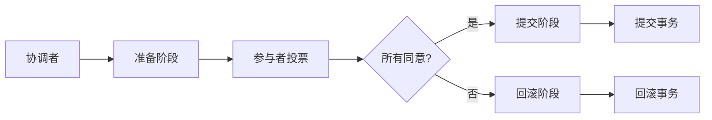
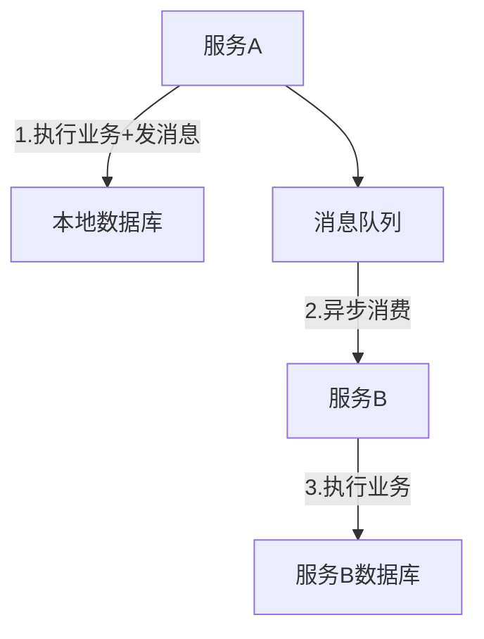

# 分布式事务：从理论到实践的完整指南

## 引言：当一致性遇上分布式

想象一下这个场景：你在电商平台下单购买了一台新手机，系统需要同时完成库存扣减、订单创建和支付处理。如果这三个操作中有一个失败，而其他成功了，会发生什么？你可能付了钱却没收到订单，或者订单创建了但库存没减少——这就是分布式事务要解决的核心问题。

在单体应用时代，数据库事务（ACID）能很好地保证数据一致性。但当系统被拆分成多个微服务，每个服务都有自己的数据库时，传统的事务机制就失效了。今天，我们就来深入探讨分布式事务的解决方案。

## 分布式事务的挑战

### CAP定理的约束
首先必须理解CAP定理：在分布式系统中，一致性（Consistency）、可用性（Availability）、分区容错性（Partition Tolerance）三者不可兼得。这意味着我们必须根据业务场景做出权衡。

### 常见问题场景
1. **网络延迟和故障**：服务间通信可能失败
2. **服务不可用**：某个微服务可能宕机
3. **数据不一致**：部分成功部分失败的情况

## 主流解决方案对比

### 1. 两阶段提交（2PC）——经典的“保守派”



**工作原理**：
- 第一阶段：准备阶段，所有参与者锁定资源并返回准备状态
- 第二阶段：根据所有参与者的响应决定提交或回滚

**优点**：
- 强一致性保证
- 实现相对简单

**缺点**：
- 同步阻塞，性能较差
- 协调者单点故障风险
- 数据锁定时间长

**适用场景**：对一致性要求极高，且事务参与者较少的场景

### 2. TCC模式——灵活的"补偿者"

TCC（Try-Confirm-Cancel）通过业务层面的补偿机制实现最终一致性。

**三个阶段**：
- **Try**：预留资源（如冻结库存）
- **Confirm**：确认执行业务（实际扣减）
- **Cancel**：取消操作（释放冻结的资源）

```java
// 伪代码示例
public class OrderService {
    public boolean createOrder(Order order) {
        try {
            // Try阶段
            inventoryService.freezeStock(order.getItems());
            couponService.lockCoupon(order.getCouponId());
            
            // Confirm阶段
            inventoryService.reduceStock(order.getItems());
            couponService.useCoupon(order.getCouponId());
            orderDao.save(order);
            
        } catch (Exception e) {
            // Cancel阶段
            inventoryService.unfreezeStock(order.getItems());
            couponService.unlockCoupon(order.getCouponId());
            throw e;
        }
    }
}
```

**实践经验**：
- 需要为每个参与者实现三个方法
- 保证操作的幂等性
- 建议设置合理的重试机制

### 3. 基于消息的最终一致性——"异步协调者"

这是目前微服务架构中最常用的方案之一。

**核心思想**：
1. 本地事务与消息发送绑定
2. 通过消息队列异步通知其他服务
3. 消费者保证幂等处理



**实现要点**：
- 使用本地消息表保证消息必达
- 消息队列需要支持事务消息（如RocketMQ）
- 消费者需要实现幂等性

### 4. Saga模式——长事务的解决方案

适合业务流程长、步骤多的场景。

**两种实现方式**：
- **协同式**：每个服务完成后通知下一个服务
- **编排式**：由协调器统一调度

## 实战建议：如何选择合适方案？

### 决策矩阵

| 方案 | 一致性强度 | 性能影响 | 实现复杂度 | 适用场景 |
|------|-----------|----------|-----------|----------|
| 2PC | 强一致性 | 高 | 低 | 金融核心交易 |
| TCC | 最终一致性 | 中 | 高 | 电商、订单系统 |
| 消息队列 | 最终一致性 | 低 | 中 | 大多数业务场景 |
| Saga | 最终一致性 | 低 | 高 | 长流程业务 |

### 我的经验分享

1. **优先考虑最终一致性**
   - 80%的业务场景不需要强一致性
   - 最终一致性方案性能更好，可用性更高

2. **设计幂等操作**
   ```java
   // 使用唯一ID保证幂等
   public void processOrder(String orderId) {
       if (processedOrders.contains(orderId)) {
           return; // 已处理过
       }
       // 处理逻辑...
       processedOrders.add(orderId);
   }
   ```

3. **设置合理的超时和重试**
   - 避免无限重试
   - 使用指数退避策略
   - 设置最大重试次数

4. **监控和告警必不可少**
   - 监控事务成功率
   - 设置死信队列告警
   - 定期对账检查数据一致性

## 常见陷阱与规避方法

### 陷阱1：过度设计
**问题**：为所有业务都实现强一致性
**解决**：根据业务重要性分级处理，核心业务用强一致性，边缘业务用最终一致性

### 陷阱2：忽略幂等性
**问题**：消息重复消费导致数据错误
**解决**：所有消费端都必须实现幂等逻辑

### 陷阱3：事务边界过大
**问题**：一个事务包含太多操作，锁定资源时间过长
**解决**：合理拆分事务，使用Saga管理长事务

## 未来趋势

1. **Service Mesh集成**：在基础设施层提供分布式事务支持
2. **Serverless适配**：无服务器架构下的新挑战
3. **AI辅助决策**：智能选择最优事务策略

## 结语

分布式事务没有银弹，最好的方案取决于你的具体业务场景。记住这些原则：
- 能不用分布式事务就不用
- 能用最终一致性就不用强一致性
- 设计时要考虑失败，而不是假设一切顺利

在实际项目中，我建议从简单的基于消息的最终一致性开始，随着业务复杂度增加再逐步引入更复杂的方案。毕竟，在分布式系统的世界里，有时候"足够好"比"完美"更实用。

希望这篇指南能帮助你在分布式事务的迷宫中找到方向。如果你有更多经验或问题，欢迎在评论区分享讨论！

---
**延伸阅读**：
- 《Designing Data-Intensive Applications》第7、9章
- 阿里云分布式事务解决方案GTS
- Apache Seata开源项目

*本文基于实际项目经验总结，具体实现请根据技术栈和业务需求调整。*