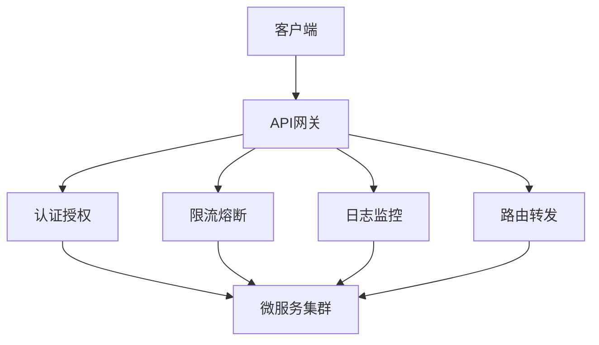

# API网关设计与实现：现代微服务架构的核心枢纽

## 引言：为什么需要API网关？

在微服务架构日益普及的今天，一个典型的电商系统可能包含数十甚至上百个独立的微服务：用户服务、商品服务、订单服务、支付服务等。每个服务都通过RESTful API或gRPC接口对外提供服务。然而，这种分布式架构带来了新的挑战：

1. **客户端复杂性**：移动端、Web端、第三方开发者需要了解每个服务的具体地址和接口规范
2. **安全风险**：每个服务都需要实现认证、授权、限流等安全机制
3. **运维困难**：服务版本管理、监控、日志收集变得复杂
4. **性能瓶颈**：频繁的服务间调用导致网络延迟增加

API网关应运而生，它作为系统的统一入口，解决了上述问题。本文将深入探讨API网关的设计原理、实现细节和最佳实践。

## 技术原理详解

### 1. 核心架构模式

API网关通常采用**反向代理**模式，所有外部请求首先到达网关，由网关根据路由规则转发到相应的后端服务。这种设计实现了**关注点分离**，将横切关注点（cross-cutting concerns）从业务服务中剥离。



### 2. 关键技术组件

#### 2.1 路由引擎
路由是API网关的核心功能，支持：
- **路径匹配**：`/api/users/*` 匹配所有用户相关请求
- **方法匹配**：GET、POST、PUT、DELETE等HTTP方法
- **头部匹配**：根据请求头进行路由
- **权重路由**：A/B测试、蓝绿部署

#### 2.2 过滤器链
网关通过过滤器链实现各种功能：
```python
# 过滤器链示例
class FilterChain:
    def __init__(self):
        self.filters = []
    
    def add_filter(self, filter):
        self.filters.append(filter)
    
    def execute(self, request, response):
        for filter in self.filters:
            if not filter.pre_process(request):
                return False
        # 转发请求到后端
        # ...
        for filter in reversed(self.filters):
            filter.post_process(response)
        return True
```

#### 2.3 熔断器模式
防止级联故障，提高系统弹性：
```java
// 熔断器状态机
enum CircuitBreakerState {
    CLOSED,    // 正常状态，请求通过
    OPEN,      // 熔断状态，直接失败
    HALF_OPEN  // 半开状态，试探性放行
}

class CircuitBreaker {
    private int failureThreshold = 5;
    private long timeout = 5000; // 5秒
    private int failureCount = 0;
    private long lastFailureTime = 0;
    private CircuitBreakerState state = CLOSED;
    
    public boolean allowRequest() {
        if (state == CLOSED) return true;
        if (state == OPEN) {
            if (System.currentTimeMillis() - lastFailureTime > timeout) {
                state = HALF_OPEN;
                return true;
            }
            return false;
        }
        return true; // HALF_OPEN状态允许试探请求
    }
}
```

### 3. 性能优化技术

#### 3.1 连接池管理
复用HTTP连接，减少TCP握手开销：
```go
// Go语言连接池示例
type ConnectionPool struct {
    pool     chan *http.Client
    maxSize  int
    timeout  time.Duration
}

func NewConnectionPool(maxSize int, timeout time.Duration) *ConnectionPool {
    return &ConnectionPool{
        pool:    make(chan *http.Client, maxSize),
        maxSize: maxSize,
        timeout: timeout,
    }
}

func (p *ConnectionPool) Get() *http.Client {
    select {
    case client := <-p.pool:
        return client
    default:
        return &http.Client{Timeout: p.timeout}
    }
}

func (p *ConnectionPool) Put(client *http.Client) {
    select {
    case p.pool <- client:
    default:
        // 连接池已满，丢弃连接
    }
}
```

#### 3.2 缓存策略
- **响应缓存**：缓存后端服务的响应
- **令牌缓存**：缓存认证令牌验证结果
- **路由缓存**：缓存路由匹配结果

## 实战代码示例

### 示例1：基于Go的简单API网关实现

```go
package main

import (
    "fmt"
    "log"
    "net/http"
    "net/http/httputil"
    "net/url"
    "strings"
)

// 路由配置
type Route struct {
    Path    string
    Target  string
    Methods []string
}

// API网关结构体
type APIGateway struct {
    routes []Route
    proxy  *httputil.ReverseProxy
}

func NewAPIGateway() *APIGateway {
    return &APIGateway{
        routes: []Route{
            {Path: "/api/users", Target: "http://localhost:8081", Methods: []string{"GET", "POST"}},
            {Path: "/api/orders", Target: "http://localhost:8082", Methods: []string{"GET", "POST", "PUT"}},
            {Path: "/api/products", Target: "http://localhost:8083", Methods: []string{"GET"}},
        },
    }
}

// 认证中间件
func (g *APIGateway) authMiddleware(next http.HandlerFunc) http.HandlerFunc {
    return func(w http.ResponseWriter, r *http.Request) {
        token := r.Header.Get("Authorization")
        if token == "" {
            http.Error(w, "Unauthorized", http.StatusUnauthorized)
            return
        }
        // 验证token逻辑
        if !validateToken(token) {
            http.Error(w, "Invalid token", http.StatusForbidden)
            return
        }
        next(w, r)
    }
}

// 路由处理
func (g *APIGateway) handleRequest(w http.ResponseWriter, r *http.Request) {
    for _, route := range g.routes {
        if strings.HasPrefix(r.URL.Path, route.Path) {
            // 检查HTTP方法
            methodAllowed := false
            for _, method := range route.Methods {
                if r.Method == method {
                    methodAllowed = true
                    break
                }
            }
            
            if !methodAllowed {
                http.Error(w, "Method not allowed", http.StatusMethodNotAllowed)
                return
            }
            
            // 创建反向代理
            target, _ := url.Parse(route.Target)
            proxy := httputil.NewSingleHostReverseProxy(target)
            
            // 添加请求头
            r.Header.Set("X-Forwarded-Host", r.Host)
            r.Header.Set("X-Origin-Service", "api-gateway")
            
            // 转发请求
            proxy.ServeHTTP(w, r)
            return
        }
    }
    
    http.Error(w, "Not found", http.StatusNotFound)
}

func validateToken(token string) bool {
    // 实现token验证逻辑
    return strings.HasPrefix(token, "Bearer ")
}

func main() {
    gateway := NewAPIGateway()
    
    // 注册处理器
    http.HandleFunc("/", gateway.authMiddleware(gateway.handleRequest))
    
    // 启动服务
    fmt.Println("API Gateway listening on :8080")
    log.Fatal(http.ListenAndServe(":8080", nil))
}
```

### 示例2：限流器实现

```python
import time
from threading import Lock
from datetime import datetime, timedelta

class TokenBucket:
    """令牌桶限流算法"""
    
    def __init__(self, capacity, fill_rate):
        """
        capacity: 桶容量
        fill_rate: 每秒填充的令牌数
        """
        self.capacity = float(capacity)
        self.tokens = float(capacity)
        self.fill_rate = float(fill_rate)
        self.last_time = time.time()
        self.lock = Lock()
    
    def consume(self, tokens=1):
        """消费令牌，返回是否成功"""
        with self.lock:
            if tokens <= self._get_current_tokens():
                self.tokens -= tokens
                return True
            return False
    
    def _get_current_tokens(self):
        """获取当前令牌数"""
        now = time.time()
        if self.tokens < self.capacity:
            delta = self.fill_rate * (now - self.last_time)
            self.tokens = min(self.capacity, self.tokens + delta)
        self.last_time = now
        return self.tokens

class RateLimiter:
    """分布式限流器（简化版）"""
    
    def __init__(self, requests_per_minute=60):
        self.limiters = {}
        self.requests_per_minute = requests_per