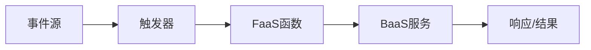

# Serverless架构：优势、挑战与实战指南

## 引言：从传统架构到无服务器计算的演进

在云计算发展的早期阶段，企业需要自行管理物理服务器、虚拟机和容器。随着云原生技术的成熟，一种新的计算范式——Serverless（无服务器）架构应运而生。这种架构模式让开发者能够专注于编写业务逻辑，而无需关心底层基础设施的管理。

**技术术语解释**：Serverless（无服务器）并不是真的没有服务器，而是指开发者无需关心服务器的配置、维护和扩展，这些工作由云服务提供商自动处理。

传统架构面临的核心问题包括：
- 资源利用率低（服务器在空闲时仍需付费）
- 运维复杂度高
- 扩展性响应慢
- 开发部署周期长

Serverless架构通过事件驱动、按需执行的方式，为解决这些问题提供了新的思路。

## 技术原理详解

### 核心组件与工作流程

Serverless架构主要由以下组件构成：

1. **函数即服务（FaaS）**：如AWS Lambda、Azure Functions、Google Cloud Functions
2. **后端即服务（BaaS）**：数据库、存储、认证等托管服务
3. **事件源**：触发函数执行的各种事件（HTTP请求、消息队列、定时器等）



### 关键技术特性

**冷启动与热启动**：
- 冷启动：函数首次执行时需要初始化运行环境（100ms-数秒）
- 热启动：函数实例已预热，直接执行（通常<100ms）

**自动扩缩容**：
- 根据负载自动创建或销毁函数实例
- 从0到数千实例的弹性扩展

**计费模型**：
- 按实际执行时间和内存使用量计费
- 通常有免费额度（如AWS Lambda每月100万次免费调用）

## 实战代码示例

### 示例1：AWS Lambda函数处理API请求

```python
import json
import boto3
from datetime import datetime

# 初始化DynamoDB客户端
dynamodb = boto3.resource('dynamodb')
table = dynamodb.Table('UserVisits')

def lambda_handler(event, context):
    """
    处理HTTP API请求，记录用户访问信息
    """
    try:
        # 解析请求参数
        user_id = event.get('queryStringParameters', {}).get('userId', 'anonymous')
        ip_address = event.get('requestContext', {}).get('identity', {}).get('sourceIp', 'unknown')
        
        # 记录访问信息
        response = table.put_item(
            Item={
                'visitId': context.aws_request_id,
                'userId': user_id,
                'ipAddress': ip_address,
                'timestamp': datetime.utcnow().isoformat(),
                'ttl': int(datetime.utcnow().timestamp()) + 86400  # 24小时后过期
            }
        )
        
        # 返回响应
        return {
            'statusCode': 200,
            'headers': {
                'Content-Type': 'application/json',
                'Access-Control-Allow-Origin': '*'
            },
            'body': json.dumps({
                'message': 'Visit recorded successfully',
                'visitId': context.aws_request_id,
                'timestamp': datetime.utcnow().isoformat()
            })
        }
        
    except Exception as e:
        return {
            'statusCode': 500,
            'body': json.dumps({'error': str(e)})
        }
```

### 示例2：Azure Functions处理图像处理任务

```csharp
using Microsoft.AspNetCore.Http;
using Microsoft.AspNetCore.Mvc;
using Microsoft.Azure.WebJobs;
using Microsoft.Azure.WebJobs.Extensions.Http;
using Microsoft.Extensions.Logging;
using SixLabors.ImageSharp;
using SixLabors.ImageSharp.Processing;
using System.IO;
using System.Threading.Tasks;

public static class ImageProcessingFunction
{
    [FunctionName("ResizeImage")]
    public static async Task<IActionResult> Run(
        [HttpTrigger(AuthorizationLevel.Function, "post", Route = null)] HttpRequest req,
        [Blob("images/{rand-guid}.jpg", FileAccess.Write)] Stream outputBlob,
        ILogger log)
    {
        log.LogInformation("Image processing function triggered.");
        
        try
        {
            // 从请求中获取图像
            var formData = await req.ReadFormAsync();
            var file = formData.Files["image"];
            
            using (var inputStream = file.OpenReadStream())
            using (var image = await Image.LoadAsync(inputStream))
            {
                // 调整图像大小
                image.Mutate(x => x.Resize(new ResizeOptions
                {
                    Size = new Size(800, 600),
                    Mode = ResizeMode.Max
                }));
                
                // 保存到Blob存储
                await image.SaveAsJpegAsync(outputBlob);
                
                return new OkObjectResult(new
                {
                    message = "Image processed successfully",
                    size = $"{image.Width}x{image.Height}",
                    blobUrl = $"https://yourstorage.blob.core.windows.net/images/{Guid.NewGuid()}.jpg"
                });
            }
        }
        catch (Exception ex)
        {
            log.LogError($"Error processing image: {ex.Message}");
            return new BadRequestObjectResult($"Error: {ex.Message}");
        }
    }
}
```

### 示例3：Google Cloud Functions处理Pub/Sub消息

```javascript
/**
 * 处理来自Pub/Sub的消息
 * @param {object} pubSubEvent - Pub/Sub事件对象
 * @param {object} context - 函数上下文
 */
exports.processOrder = async (pubSubEvent, context) => {
  const { PubSub } = require('@google-cloud/pubsub');
  const { BigQuery } = require('@google-cloud/bigquery');
  
  // 初始化客户端
  const pubsub = new PubSub();
  const bigquery = new BigQuery();
  
  try {
    // 解码消息数据
    const messageData = JSON.parse(
      Buffer.from(pubSubEvent.data, 'base64').toString()
    );
    
    console.log(`Processing order: ${messageData.orderId}`);
    
    // 验证订单数据
    if (!validateOrder(messageData)) {
      throw new Error('Invalid order data');
    }
    
    // 插入到BigQuery进行分析
    const datasetId = 'orders_dataset';
    const tableId = 'orders_table';
    
    await bigquery
      .dataset(datasetId)
      .table(tableId)
      .insert([{
        orderId: messageData.orderId,
        customerId: messageData.customerId,
        amount: messageData.amount,
        items: JSON.stringify(messageData.items),
        timestamp: new Date().toISOString(),
        status: 'processed'
      }]);
    
    console.log(`Order ${messageData.orderId} processed successfully`);
    
    // 发布处理完成的消息
    const topic = pubsub.topic('order-processed');
    await topic.publishMessage({
      data: Buffer.from(JSON.stringify({
        orderId: messageData.orderId,
        status: 'completed',
        processedAt: new Date().toISOString()
      }))
    });
    
  } catch (error) {
    console.error(`Error processing order: ${error.message}`);
    
    // 发布错误消息到死信队列
    const dlqTopic = pubsub.topic('order-dlq');
    await dlqTopic.publishMessage({
      data: Buffer.from(JSON.stringify({
        originalMessage: pubSubEvent.data,
        error: error.message,
        timestamp: new Date().toISOString()
      }))
    });
    
    throw error;
  }
};

function validateOrder(order) {
  return order && 
         order.orderId && 
         order.customerId && 
         order.amount > 0;
}
```

## Serverless架构的优势

### 1. 成本效益
- **按使用付费**：只在代码执行时计费
- **无闲置成本**：没有运行中的服务器需要维护
- **自动扩缩容**：无需为峰值负载过度配置资源

### 2. 运维简化
- **零服务器管理**：无需打补丁、监控服务器健康
- **内置高可用性**：自动跨可用区部署
- **简化部署**：只需上传代码，无需管理基础设施

### 3. 弹性扩展
- **毫秒级扩展**：从0到数千实例的自动扩展
- **处理突发流量**：轻松应对流量高峰
- **精细扩展**：每个函数独立扩展

### 4. 开发效率
- **快速迭代**：专注于业务逻辑
- **微服务友好**：天然支持微服务架构
- **多语言支持**：支持多种编程语言

## Serverless架构的挑战与解决方案

### 挑战1：冷启动延迟
**问题**：函数首次调用或长时间未调用后的延迟较高

**解决方案**：
```python
# 使用预热策略保持函数热启动
import time

def lambda_handler(event, context):
    # 检查是否为预热请求
    if event.get('source') == 'aws.events' and event.get