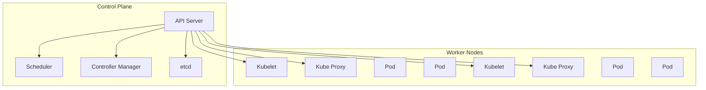

# Kubernetes在生产环境中的深度应用：从原理到实践

## 引言：现代应用部署的挑战

在传统的应用部署模式中，运维团队面临着诸多挑战：环境不一致导致的"在我机器上能运行"问题、资源利用率低下、扩展性差、故障恢复缓慢等。随着微服务架构的普及，这些问题变得更加突出。一个典型的电商应用可能由数十个甚至上百个微服务组成，每个服务都需要独立的部署、监控和扩展。

**Kubernetes**（常简称为K8s）作为容器编排的事实标准，正是为了解决这些问题而生。它提供了一个统一的平台，用于自动化部署、扩展和管理容器化应用。根据CNCF 2023年的调查报告，**96%的组织正在使用或评估Kubernetes**，其中78%已将其用于生产环境。

## 技术原理详解

### 核心架构组件

Kubernetes采用主从架构，主要由以下核心组件构成：



#### 控制平面（Control Plane）
- **API Server**：所有操作的入口点，提供RESTful API
- **etcd**：分布式键值存储，保存集群状态
- **Scheduler**：将Pod调度到合适的节点
- **Controller Manager**：运行各种控制器，确保实际状态与期望状态一致

#### 工作节点（Worker Nodes）
- **Kubelet**：节点代理，管理Pod生命周期
- **Kube Proxy**：维护网络规则，实现服务发现和负载均衡
- **容器运行时**：如Docker、containerd等

### 关键概念解析

**Pod**：Kubernetes的最小部署单元，包含一个或多个紧密相关的容器。Pod内的容器共享网络命名空间和存储卷。

**Service**：定义一组Pod的访问策略，提供稳定的IP地址和DNS名称，实现负载均衡。

**Deployment**：声明式地管理Pod副本集，支持滚动更新和回滚。

**ConfigMap & Secret**：将配置信息和敏感数据与容器镜像解耦。

**Namespace**：虚拟集群，用于资源隔离和多租户管理。

## 实战代码示例

### 示例1：完整的微服务部署配置

以下是一个完整的Web应用部署示例，包含Deployment、Service和Horizontal Pod Autoscaler：

```yaml
# webapp-deployment.yaml
apiVersion: apps/v1
kind: Deployment
metadata:
  name: webapp
  namespace: production
  labels:
    app: webapp
    environment: production
spec:
  replicas: 3
  revisionHistoryLimit: 3  # 保留3个历史版本用于回滚
  selector:
    matchLabels:
      app: webapp
  strategy:
    type: RollingUpdate
    rollingUpdate:
      maxSurge: 1          # 更新时最多可超出期望副本数1个
      maxUnavailable: 0    # 更新时保证至少所有副本都可用
  template:
    metadata:
      labels:
        app: webapp
        version: v1.2.0
    spec:
      containers:
      - name: webapp
        image: myregistry/webapp:v1.2.0
        imagePullPolicy: IfNotPresent
        ports:
        - containerPort: 8080
          name: http
        env:
        - name: NODE_ENV
          value: "production"
        - name: DB_HOST
          valueFrom:
            configMapKeyRef:
              name: app-config
              key: db.host
        resources:
          requests:
            memory: "256Mi"
            cpu: "250m"
          limits:
            memory: "512Mi"
            cpu: "500m"
        livenessProbe:
          httpGet:
            path: /health
            port: 8080
          initialDelaySeconds: 30
          periodSeconds: 10
          timeoutSeconds: 5
          failureThreshold: 3
        readinessProbe:
          httpGet:
            path: /ready
            port: 8080
          initialDelaySeconds: 5
          periodSeconds: 5
        volumeMounts:
        - name: config-volume
          mountPath: /etc/app/config
      volumes:
      - name: config-volume
        configMap:
          name: app-config
      affinity:
        podAntiAffinity:
          preferredDuringSchedulingIgnoredDuringExecution:
          - weight: 100
            podAffinityTerm:
              labelSelector:
                matchExpressions:
                - key: app
                  operator: In
                  values:
                  - webapp
              topologyKey: kubernetes.io/hostname
---
apiVersion: v1
kind: Service
metadata:
  name: webapp-service
  namespace: production
spec:
  selector:
    app: webapp
  ports:
  - port: 80
    targetPort: 8080
    protocol: TCP
    name: http
  type: ClusterIP
---
apiVersion: autoscaling/v2
kind: HorizontalPodAutoscaler
metadata:
  name: webapp-hpa
  namespace: production
spec:
  scaleTargetRef:
    apiVersion: apps/v1
    kind: Deployment
    name: webapp
  minReplicas: 3
  maxReplicas: 10
  metrics:
  - type: Resource
    resource:
      name: cpu
      target:
        type: Utilization
        averageUtilization: 70
  - type: Resource
    resource:
      name: memory
      target:
        type: Utilization
        averageUtilization: 80
  behavior:
    scaleDown:
      stabilizationWindowSeconds: 300
      policies:
      - type: Percent
        value: 50
        periodSeconds: 60
    scaleUp:
      stabilizationWindowSeconds: 60
      policies:
      - type: Percent
        value: 100
        periodSeconds: 60
```

### 示例2：使用ConfigMap管理配置

```yaml
# configmap.yaml
apiVersion: v1
kind: ConfigMap
metadata:
  name: app-config
  namespace: production
data:
  app.properties: |
    server.port=8080
    logging.level.root=INFO
    spring.datasource.url=jdbc:mysql://db-service:3306/appdb
    cache.ttl=3600
    
  db.host: "db-service.production.svc.cluster.local"
  db.port: "3306"
  
  feature-flags.properties: |
    feature.new_checkout=true
    feature.recommendations=false
    feature.analytics_dashboard=true
```

### 示例3：高级网络策略配置

```yaml
# network-policy.yaml
apiVersion: networking.k8s.io/v1
kind: NetworkPolicy
metadata:
  name: webapp-network-policy
  namespace: production
spec:
  podSelector:
    matchLabels:
      app: webapp
  policyTypes:
  - Ingress
  - Egress
  ingress:
  - from:
    - namespaceSelector:
        matchLabels:
          name: ingress-namespace
    - podSelector:
        matchLabels:
          app: load-balancer
    ports:
    - protocol: TCP
      port: 8080
  egress:
  - to:
    - podSelector:
        matchLabels:
          app: database
    ports:
    - protocol: TCP
      port: 3306
  - to:
    - podSelector:
        matchLabels:
          app: redis
    ports:
    - protocol: TCP
      port: 6379
  - to:
    - ipBlock:
        cidr: 10.0.0.0/8
        except:
        - 10.1.0.0/16
    ports:
    - protocol: TCP
      port: 443
```

## 最佳实践建议

### 1. 资源管理与优化

**资源请求和限制**：始终为容器设置合理的资源请求（requests）和限制（limits）。这有助于调度器做出更好的决策，并防止单个Pod消耗过多资源。

```bash
# 查看资源使用情况
kubectl top pods --namespace production
kubectl top nodes

# 设置资源配额
kubectl create quota production-quota \
  --hard=cpu=20,memory=64Gi,pods=100 \
  --namespace=production
```

### 2. 高可用性设计

- **多副本部署**：关键服务至少部署3个副本
- **Pod反亲和性**：确保Pod分布在不同的节点上
-