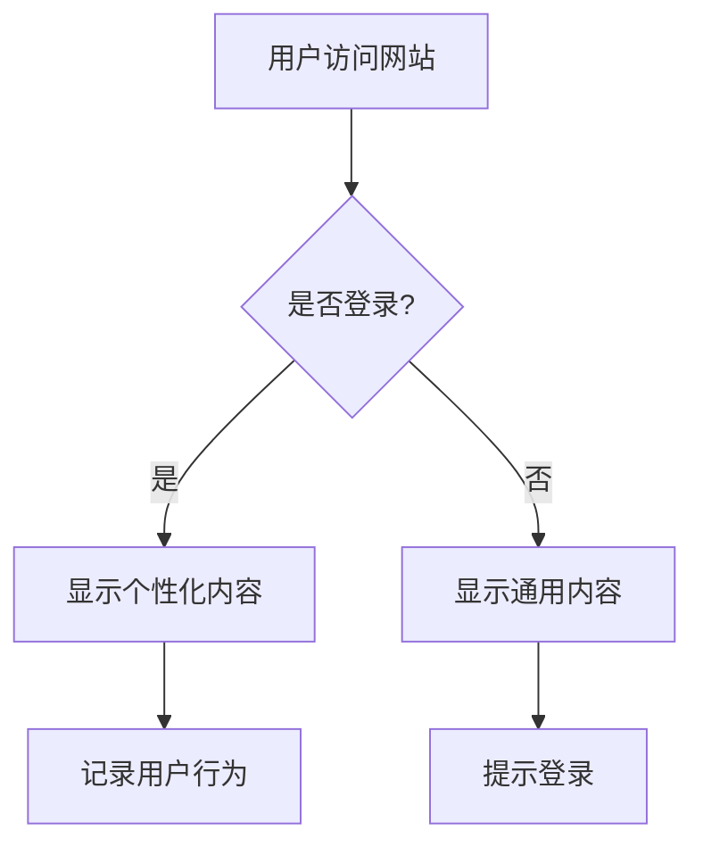

# 技术博客写作的艺术：从零到一打造高质量技术内容

> 好的技术博客不仅是知识的传递，更是思想的碰撞和技能的展示。掌握写作技巧，让你的技术见解影响更多人。

## 为什么技术博客写作如此重要？

在技术领域，写作能力常常被低估。但事实上，**写作是思考的延伸**。当你尝试用文字解释一个复杂概念时，你首先必须自己完全理解它。这个过程会暴露你知识体系中的漏洞，迫使你深入思考。

技术博客写作还能：
- 建立个人品牌和专业声誉
- 加深对技术的理解
- 帮助他人解决问题
- 创造职业发展机会
- 构建技术社区影响力

## 第一步：找到你的“技术写作声音”

### 确定你的目标读者
在动笔之前，先问自己三个问题：
1. 这篇文章写给谁看？（初学者、中级开发者、专家？）
2. 他们想从这篇文章中获得什么？
3. 他们可能已经知道什么，不知道什么？

**实用技巧**：想象一个具体的读者形象，比如“有1-2年React经验的前端开发者”，然后为这个“人”写作。

### 找到你的独特视角
技术领域已经有太多重复的内容。你的价值在于：
- **独特的项目经验**：分享你在实际项目中遇到的真实问题和解决方案
- **不同的学习路径**：你如何理解某个复杂概念的过程
- **跨领域的见解**：将其他领域的知识应用到技术问题中

## 第二步：结构是王道——技术博客的黄金结构

### 1. 引人入胜的标题
好的标题应该：
- 明确文章主题
- 暗示读者将获得的收益
- 包含相关关键词（利于SEO）
- 激发好奇心

**示例对比**：
- ❌ “React Hooks介绍”
- ✅ “React Hooks实战：5个让你的代码更简洁的模式”

### 2. 开篇即抓住注意力
前100字决定读者是否继续阅读。尝试这些开场方式：
- 提出一个常见痛点
- 分享一个令人惊讶的事实或统计数据
- 讲述一个简短的个人故事
- 提出一个引人深思的问题

### 3. 清晰的内容结构
使用层次分明的标题和子标题：

```markdown
# 主标题
## 二级标题
### 三级标题
- 列表项
- 列表项
```

**黄金结构模板**：
1. 问题/痛点介绍
2. 传统解决方案及其局限性
3. 你的解决方案/方法
4. 逐步实现指南
5. 最佳实践和注意事项
6. 总结和下一步建议

### 4. 强有力的结尾
不要突然结束！好的结尾应该：
- 总结关键要点
- 提供进一步学习的资源
- 邀请读者评论或提问
- 如果有，预告下一篇相关内容

## 第三步：让技术内容“活”起来

### 代码示例的艺术
```javascript
// ❌ 糟糕的示例：缺乏上下文
function calculate(a,b) {
  return a + b;
}

// ✅ 好的示例：有注释、有上下文、有实际用例
/**
 * 计算订单总价（含税）
 * @param {number} subtotal - 小计金额
 * @param {number} taxRate - 税率（如0.08表示8%）
 * @returns {number} 含税总价
 * @example
 * // 计算100元商品在8%税率下的总价
 * calculateTotal(100, 0.08); // 返回108
 */
function calculateTotal(subtotal, taxRate = 0.08) {
  if (subtotal < 0) {
    throw new Error('小计金额不能为负数');
  }
  return subtotal * (1 + taxRate);
}
```

**代码展示最佳实践**：
- 保持代码片段简短（通常不超过20行）
- 添加有意义的注释
- 说明输入和输出
- 展示错误处理
- 如果有复杂代码，提供GitHub仓库链接

### 视觉辅助的力量
1. **图表和流程图**：使用Mermaid、Draw.io等工具
2. **对比表格**：清晰展示不同方案优劣
3. **截图和GIF**：展示UI变化或操作流程
4. **信息图**：总结复杂概念



## 第四步：写作流程优化

### 从大纲开始，不要从空白页开始
我的写作流程：
1. **头脑风暴**（15分钟）：列出所有相关想法，不评判
2. **创建大纲**（30分钟）：组织想法，建立结构
3. **填充内容**（90分钟）：按照大纲写作，不追求完美
4. **休息**（至少1小时）：让大脑放松
5. **编辑修改**（45分钟）：检查逻辑、语言、技术准确性
6. **最终检查**（15分钟）：格式、链接、代码示例

### 技术准确性的保证
1. **测试所有代码示例**：确保它们真的能运行
2. **验证版本兼容性**：注明你使用的技术版本
3. **引用可靠来源**：链接到官方文档或权威文章
4. **注明假设和限制**：说明你的方案在什么条件下有效

## 第五步：超越文字——提升读者体验

### 可访问性考虑
- 为图片添加alt文本
- 使用足够的颜色对比度
- 确保代码高亮清晰可读
- 使用描述性的链接文本（不要用“点击这里”）

### 交互元素
- 添加可运行的代码沙盒（CodePen、JSFiddle）
- 创建交互式图表
- 提供下载资源或模板
- 添加小测验或练习

### SEO基础
1. **关键词研究**：在标题、前100字、子标题中使用目标关键词
2. **内部链接**：链接到你自己的相关文章
3. **外部链接**：链接到权威来源
4. **元描述**：编写吸引点击的摘要
5. **优化图片**：压缩大小，添加描述性文件名和alt文本

## 第六步：发布后的工作

### 推广你的内容
- 在相关技术社区分享（但遵守社区规则）
- 在社交媒体上发布，使用合适的话题标签
- 发送给可能感兴趣的朋友或同事
- 在技术论坛回答问题时，链接到相关文章

### 与读者互动
- 及时回复评论
- 根据反馈更新文章
- 将常见问题添加到文章中
- 感谢有价值的反馈

### 持续改进
- 使用分析工具了解读者行为
- A/B测试不同的标题或开头
- 定期更新旧文章，确保信息不过时
- 从高绩效文章中学习成功模式

## 常见陷阱及避免方法

### 陷阱1：过于学术化
**问题**：使用过多术语，缺乏实际示例
**解决**：每个技术概念配一个实际用例

### 陷阱2：假设读者背景
**问题**：跳过基础步骤，让初学者跟不上
**解决**：定义关键术语，提供必要背景

### 陷阱3：缺乏重点
**问题**：一篇文章试图覆盖太多主题
**解决**：一篇文章解决一个问题，深入而非广泛

### 陷阱4：忽视故事性
**问题**：纯技术描述，枯燥乏味
**解决**：从问题或故事开始，展示技术如何解决实际问题

## 我的个人工具箱推荐

### 写作工具
- **Typora**：极简Markdown编辑器
- **Grammarly**：语法和风格检查
- **Hemingway Editor**：提高可读性

### 技术工具
- **Carbon**：创建美观的代码截图
- **Mermaid Live Editor**：创建图表
- **CodePen/JSFiddle**：嵌入式代码示例

### 发布平台
- **个人博客**（最大控制权）
- **Dev.to**（优秀的技术社区）
- **Medium**（广泛的读者群）
- **公司技术博客**（建立专业声誉）

## 开始行动：你的第一个30天计划

**第一周**：分析3篇你欣赏的技术博客，拆解它们的结构
**第二周**：写一篇500字的短文，解释一个你熟悉的技术概念
**第三周**：基于实际项目经验，写一篇完整教程
**第四周**：推广你的文章，收集反馈，计划下一篇

记住，技术写作是一项技能，**通过练习可以不断提高**。不要追求完美，而是追求进步。每篇文章都是学习的机会。

---

**最后的小建议**：保持写作的乐趣。当你对某个技术感到兴奋时，那种热情会通过文字传递给读者。技术是冰冷的，但分享知识的过程可以是温暖的。

现在，打开你的编辑器，开始写下第一篇技术博客吧！🚀

*有什么技术写作问题或经验想分享吗？欢迎在评论区留言讨论！*