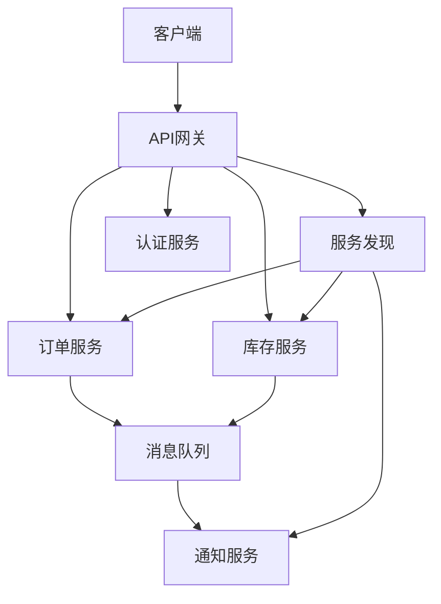

# 微服务架构设计与实现：从理论到实践

## 引言：单体架构的困境与微服务的兴起

在传统软件开发中，单体架构（Monolithic Architecture）长期占据主导地位。这种架构将所有功能模块打包在一个应用程序中，共享同一个数据库和代码库。随着业务规模扩大，单体架构逐渐暴露出诸多问题：

1. **部署困难**：任何小的修改都需要重新部署整个应用
2. **技术栈僵化**：难以引入新技术或框架
3. **扩展性差**：无法针对特定模块进行独立扩展
4. **可靠性风险**：一个模块的故障可能影响整个系统
5. **团队协作瓶颈**：大型团队在同一个代码库上工作容易产生冲突

微服务架构（Microservices Architecture）应运而生，它将应用程序拆分为一组小型、独立的服务，每个服务运行在自己的进程中，通过轻量级机制（通常是HTTP/REST API）进行通信。这种架构模式使组织能够更快、更安全地交付大规模复杂应用程序。

## 技术原理详解

### 核心概念解析

**微服务**：一个微服务是一个独立的、可部署的业务单元，专注于完成单一职责。每个微服务都有自己的数据存储、业务逻辑和接口。

**服务边界划分**：通常基于业务能力（Business Capability）或领域驱动设计（DDD）的限界上下文（Bounded Context）来划分服务边界。

**服务通信模式**：
- 同步通信：REST、gRPC、GraphQL
- 异步通信：消息队列（RabbitMQ、Kafka）、事件驱动

**服务发现**：微服务需要能够发现彼此的位置。常见的模式包括：
- 客户端发现（Client-side Discovery）
- 服务端发现（Server-side Discovery）

### 架构组件



### 关键技术术语解释

**容器化（Containerization）**：使用容器技术（如Docker）将应用程序及其依赖项打包在一起，确保在不同环境中的一致性。

**编排（Orchestration）**：自动化容器的部署、管理和扩展，Kubernetes是最流行的容器编排平台。

**熔断器模式（Circuit Breaker Pattern）**：防止级联故障，当服务调用失败达到阈值时，熔断器打开，后续调用直接返回错误，不再尝试调用故障服务。

**配置中心（Configuration Center）**：集中管理所有微服务的配置信息，支持动态更新。

## 实战代码示例

### 示例1：使用Spring Boot创建微服务

```java
// OrderServiceApplication.java - 订单服务主类
@SpringBootApplication
@EnableEurekaClient
@EnableCircuitBreaker
public class OrderServiceApplication {
    public static void main(String[] args) {
        SpringApplication.run(OrderServiceApplication.class, args);
    }
}

// OrderController.java - REST控制器
@RestController
@RequestMapping("/api/orders")
public class OrderController {
    
    @Autowired
    private OrderService orderService;
    
    @Autowired
    private InventoryClient inventoryClient;
    
    @PostMapping
    @ResponseStatus(HttpStatus.CREATED)
    public Order createOrder(@RequestBody OrderRequest request) {
        // 检查库存
        InventoryResponse inventory = inventoryClient.checkInventory(
            request.getProductId(), 
            request.getQuantity()
        );
        
        if (!inventory.isAvailable()) {
            throw new InsufficientInventoryException("库存不足");
        }
        
        return orderService.createOrder(request);
    }
    
    @GetMapping("/{id}")
    public Order getOrder(@PathVariable String id) {
        return orderService.getOrderById(id);
    }
}

// 使用Feign客户端调用其他服务
@FeignClient(name = "inventory-service", fallback = InventoryClientFallback.class)
public interface InventoryClient {
    
    @GetMapping("/api/inventory/{productId}")
    InventoryResponse checkInventory(
        @PathVariable("productId") String productId,
        @RequestParam("quantity") int quantity
    );
}

// 熔断器回退实现
@Component
public class InventoryClientFallback implements InventoryClient {
    
    @Override
    public InventoryResponse checkInventory(String productId, int quantity) {
        // 返回默认响应或缓存数据
        return new InventoryResponse(productId, false, "服务暂时不可用");
    }
}
```

### 示例2：Docker容器化配置

```dockerfile
# Dockerfile for Order Service
FROM openjdk:11-jre-slim

# 设置工作目录
WORKDIR /app

# 复制JAR文件
COPY target/order-service-1.0.0.jar app.jar

# 设置JVM参数
ENV JAVA_OPTS="-Xms256m -Xmx512m -XX:+UseG1GC"

# 暴露端口
EXPOSE 8080

# 健康检查
HEALTHCHECK --interval=30s --timeout=3s \
  CMD curl -f http://localhost:8080/actuator/health || exit 1

# 启动命令
ENTRYPOINT ["sh", "-c", "java $JAVA_OPTS -jar app.jar"]
```

```yaml
# docker-compose.yml - 本地开发环境
version: '3.8'

services:
  eureka-server:
    image: springcloud/eureka-server
    ports:
      - "8761:8761"
    networks:
      - microservices-net

  order-service:
    build: ./order-service
    ports:
      - "8081:8080"
    environment:
      - EUREKA_CLIENT_SERVICEURL_DEFAULTZONE=http://eureka-server:8761/eureka
    depends_on:
      - eureka-server
    networks:
      - microservices-net

  inventory-service:
    build: ./inventory-service
    ports:
      - "8082:8080"
    environment:
      - EUREKA_CLIENT_SERVICEURL_DEFAULTZONE=http://eureka-server:8761/eureka
    depends_on:
      - eureka-server
    networks:
      - microservices-net

  api-gateway:
    build: ./api-gateway
    ports:
      - "8080:8080"
    environment:
      - EUREKA_CLIENT_SERVICEURL_DEFAULTZONE=http://eureka-server:8761/eureka
    depends_on:
      - eureka-server
    networks:
      - microservices-net

networks:
  microservices-net:
    driver: bridge
```

### 示例3：使用Kubernetes部署配置

```yaml
# order-service-deployment.yaml
apiVersion: apps/v1
kind: Deployment
metadata:
  name: order-service
  labels:
    app: order-service
spec:
  replicas: 3
  selector:
    matchLabels:
      app: order-service
  template:
    metadata:
      labels:
        app: order-service
    spec:
      containers:
      - name: order-service
        image: myregistry/order-service:1.0.0
        ports:
        - containerPort: 8080
        env:
        - name: SPRING_PROFILES_ACTIVE
          value: "prod"
        - name: EUREKA_CLIENT_SERVICEURL_DEFAULTZONE
          value: "http://eureka-server:8761/eureka"
        resources:
          requests:
            memory: "256Mi"
            cpu: "250m"
          limits:
            memory: "512Mi"
            cpu: "500m"
        livenessProbe:
          httpGet:
            path: /actuator/health/liveness
            port: 8080
          initialDelaySeconds: 60
          periodSeconds: 10
        readinessProbe:
          httpGet:
            path: /actuator/health/readiness
            port: 8080
          initialDelaySeconds: 30
          periodSeconds: 5
---
# order-service-service.yaml
apiVersion: v1
kind: Service
metadata:
  name: order-service
spec:
  selector:
    app: order-service
  ports:
  - port: 80
    targetPort: 8080
  type: ClusterIP
```

## 最佳实践建议

### 1. 服务设计原则

**单一职责原则**：每个微服务应该只负责一个特定的业务功能。

**独立部署**：服务应该能够独立部署，不影响其他服务。

**去中心化数据管理**：每个服务拥有自己的数据库，避免共享数据库模式。

**容错设计**：实现重试机制、熔断器和超时控制。

### 2. 通信策略

- 优先选择异步消息传递，减少服务间的耦合
- 使用API网关作为所有客户端的单一入口点
- 实施版本化的API，支持向后兼容

### 3. 监控与可观测性

建立完整的监控体系，包括：
- 分布式追踪（如Jaeger、Zipkin）
- 集中式日志（如ELK Stack）
- 指标监控（如