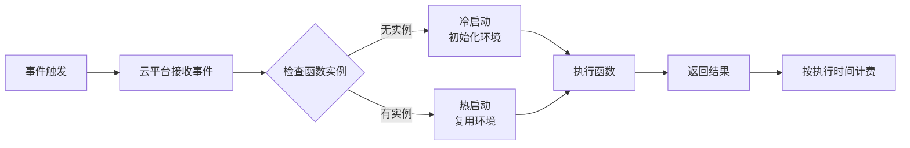

# Serverless架构：优势、挑战与实战指南

## 引言：从传统架构到无服务器计算的演进

在云计算发展的早期阶段，企业需要自行管理物理服务器、虚拟机和容器。随着云原生技术的成熟，Serverless架构应运而生，它代表了云计算演进的下一阶段。根据Gartner的预测，到2025年，超过50%的全球企业将采用Serverless架构。

**Serverless**（无服务器计算）并不意味着没有服务器，而是指开发者无需关心服务器的配置、扩展和维护。云服务提供商动态管理机器资源的分配，开发者只需专注于编写业务逻辑代码。这种模式特别适合事件驱动、按需执行的场景。

## 技术原理详解

### 核心概念解析

**函数即服务（FaaS）**：Serverless的核心组件，允许开发者部署单个函数而不是完整的应用程序。当特定事件触发时，云平台自动执行这些函数。

**事件驱动架构**：Serverless函数通常由事件触发，如HTTP请求、数据库更改、文件上传或消息队列中的消息。

**冷启动与热启动**：
- **冷启动**：函数首次执行或长时间未执行后的启动，需要初始化运行环境
- **热启动**：函数频繁执行时的快速启动，复用已有环境

### 工作流程



### 关键技术术语

- **弹性伸缩**：自动根据负载调整函数实例数量
- **按需计费**：仅对实际执行时间和资源使用量收费
- **无状态设计**：函数执行不依赖本地状态，状态存储在外部服务中
- **最大执行时间**：云平台对函数执行时间的限制（通常5-15分钟）

## 实战代码示例

### 示例1：AWS Lambda函数处理S3文件上传

```python
import json
import boto3
from PIL import Image
import io

s3_client = boto3.client('s3')

def lambda_handler(event, context):
    """
    处理S3文件上传事件，生成缩略图
    """
    # 解析S3事件
    for record in event['Records']:
        bucket = record['s3']['bucket']['name']
        key = record['s3']['object']['key']
        
        # 只处理图片文件
        if not key.lower().endswith(('.png', '.jpg', '.jpeg')):
            continue
            
        # 下载原始图片
        response = s3_client.get_object(Bucket=bucket, Key=key)
        image_data = response['Body'].read()
        
        # 使用PIL处理图片
        image = Image.open(io.BytesIO(image_data))
        
        # 生成缩略图
        thumbnail_size = (200, 200)
        image.thumbnail(thumbnail_size)
        
        # 保存缩略图到BytesIO
        thumbnail_buffer = io.BytesIO()
        image.save(thumbnail_buffer, format='JPEG')
        thumbnail_buffer.seek(0)
        
        # 上传缩略图到S3
        thumbnail_key = f"thumbnails/{key}"
        s3_client.put_object(
            Bucket=bucket,
            Key=thumbnail_key,
            Body=thumbnail_buffer,
            ContentType='image/jpeg'
        )
        
        print(f"缩略图已生成: {thumbnail_key}")
    
    return {
        'statusCode': 200,
        'body': json.dumps('处理完成')
    }
```

### 示例2：Azure Functions HTTP触发器

```csharp
using System.Net;
using Microsoft.AspNetCore.Mvc;
using Microsoft.Azure.WebJobs;
using Microsoft.Azure.WebJobs.Extensions.Http;
using Microsoft.AspNetCore.Http;
using Microsoft.Extensions.Logging;
using Newtonsoft.Json;

public static class OrderProcessor
{
    [FunctionName("ProcessOrder")]
    public static async Task<IActionResult> Run(
        [HttpTrigger(AuthorizationLevel.Function, "post", Route = null)] HttpRequest req,
        ILogger log)
    {
        log.LogInformation("C# HTTP trigger function processed a request.");

        // 读取请求体
        string requestBody = await new StreamReader(req.Body).ReadToEndAsync();
        dynamic orderData = JsonConvert.DeserializeObject(requestBody);
        
        // 验证订单数据
        if (orderData?.orderId == null || orderData?.customerId == null)
        {
            return new BadRequestObjectResult("请提供有效的订单ID和客户ID");
        }
        
        // 处理订单逻辑
        string orderId = orderData.orderId;
        string customerId = orderData.customerId;
        decimal totalAmount = orderData.totalAmount;
        
        // 模拟订单处理
        bool paymentSuccess = await ProcessPayment(orderId, totalAmount);
        
        if (paymentSuccess)
        {
            // 发送确认邮件
            await SendConfirmationEmail(customerId, orderId);
            
            // 记录到数据库
            await SaveOrderToDatabase(orderId, customerId, totalAmount);
            
            return new OkObjectResult(new {
                success = true,
                message = "订单处理成功",
                orderId = orderId,
                timestamp = DateTime.UtcNow
            });
        }
        else
        {
            return new BadRequestObjectResult("支付处理失败");
        }
    }
    
    private static async Task<bool> ProcessPayment(string orderId, decimal amount)
    {
        // 模拟支付处理
        await Task.Delay(100);
        return amount > 0;
    }
    
    private static async Task SendConfirmationEmail(string customerId, string orderId)
    {
        // 模拟发送邮件
        await Task.Delay(50);
    }
    
    private static async Task SaveOrderToDatabase(string orderId, string customerId, decimal amount)
    {
        // 模拟数据库操作
        await Task.Delay(150);
    }
}
```

### 示例3：Google Cloud Functions处理Pub/Sub消息

```javascript
/**
 * 处理来自Pub/Sub的消息
 * @param {object} pubSubEvent - Pub/Sub事件对象
 * @param {object} context - 事件上下文
 */
exports.processLogMessage = async (pubSubEvent, context) => {
  // 解码Base64编码的消息数据
  const messageData = pubSubEvent.data
    ? Buffer.from(pubSubEvent.data, 'base64').toString()
    : '{}';
  
  const logEntry = JSON.parse(messageData);
  
  // 验证日志格式
  if (!logEntry.timestamp || !logEntry.level || !logEntry.message) {
    console.error('无效的日志格式:', logEntry);
    return;
  }
  
  // 根据日志级别处理
  switch (logEntry.level.toLowerCase()) {
    case 'error':
      await handleErrorLog(logEntry);
      break;
    case 'warning':
      await handleWarningLog(logEntry);
      break;
    case 'info':
      await handleInfoLog(logEntry);
      break;
    default:
      console.log('未知日志级别:', logEntry.level);
  }
  
  // 记录处理完成
  console.log(`日志处理完成: ${logEntry.timestamp} - ${logEntry.level}`);
};

/**
 * 处理错误日志
 */
async function handleErrorLog(logEntry) {
  // 发送警报通知
  const alertData = {
    severity: 'ERROR',
    message: logEntry.message,
    timestamp: logEntry.timestamp,
    service: logEntry.service || 'unknown'
  };
  
  // 这里可以集成到监控系统如Stackdriver, Datadog等
  console.error('错误警报:', alertData);
  
  // 存储到错误数据库
  await storeErrorToDatabase(logEntry);
}

/**
 * 处理警告日志
 */
async function handleWarningLog(logEntry) {
  // 警告级别处理逻辑
  console.warn('警告日志:', logEntry);
  
  // 可以触发特定的警告处理流程
  if (logEntry.message.includes('memory')) {
    await triggerMemoryCleanup();
  }
}

/**
 * 处理信息日志
 */
async function handleInfoLog(logEntry) {
  // 信息级别处理逻辑
  console.log('信息日志:', logEntry);
  
  // 存储到分析数据库
  await storeToAnalytics(logEntry);
}

// 模拟存储函数
async function storeErrorToDatabase(logEntry) {
  // 实际实现中会连接到数据库
  return new Promise(resolve => setTimeout(resolve, 50));
}

async function triggerMemoryCleanup() {
  // 触发内存清理逻辑
  return new Promise(resolve => setTimeout(resolve, 100));
}

async function storeToAnalytics(logEntry) {
  // 存储到分析系统
  return new Promise(resolve => setTimeout(resolve, 30));
}
```

## Serverless架构的优势

### 1. 成本效益
- **按使用量计费**：仅支付函数执行时间和资源消耗
- **无闲置成本**：无需为闲置服务器付费
- **自动伸缩**：无需预置容量，根据负载自动调整

